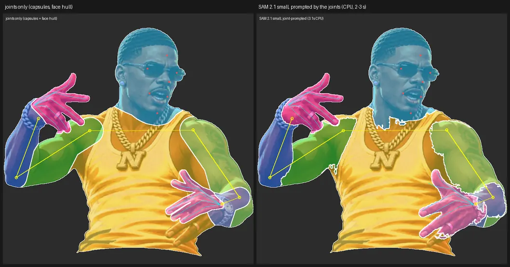
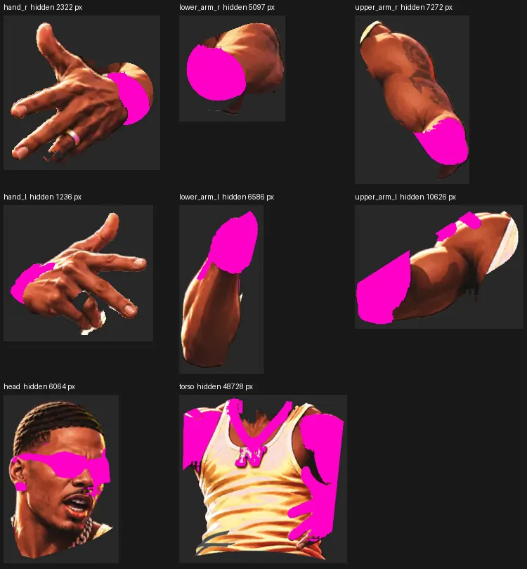
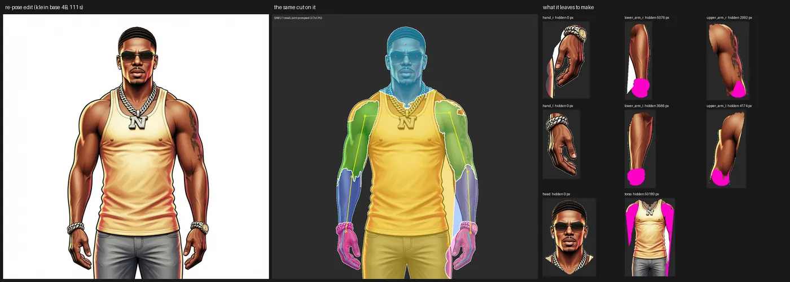

# Frame to rig — one animation frame to a rigged, skinned template character

> Status: **designed + proof of the hard steps** (2026-11-21); no app code yet, phases in §10.
> Owner tool: Invisible Rigger (`/rigger`, agent `invisible-rigger`), with the Atlas Maker
> (`services/atlas-tool`, agent `atlas-python-tools`) and the RunPod worker. Builds on:
> [rig-templates](rig-templates.md) (the templates, §5.3 MediaPipe, §6 the T6 art blueprint),
> [rig-2p5d](rig-2p5d.md) §4.7 (drawings by angle), [runpod-comfyui-backend](runpod-comfyui-backend.md).
> Proof scripts: `tools/frame-to-rig/` (not gates: they read the owner's frame, which is not in
> the repo). Pictures: `docs/design/frame-to-rig/`.

## 1. The ask

The owner, 2026-11-21: "take the first frame of the animation flipbook, so we have a split we can
animate, a sheet produced with the correctly named regions, and the regions already skinned to the
rig for animation." Art for templates is the slow part (T6's generated busts wait on a RunPod
top-up); a character that already exists as a Flipbook clip should become a template rig without
anyone cutting it by hand.

## 2. Verdict

**Build it, in the order of §10, and default to the best frame, not the first.** On the owner's
real frame (NellyAnimTest frame 0, Half body 3) the hard steps hold up:

- **Joints → cut → rig is exact and automatic.** MediaPipe's joints prompt SAM 2.1 (2–3 s on CPU
  for the whole character); the parts, placed on a skeleton fitted from the same joints and posed by
  engine-rig, redraw the frame at alpha IoU **0.998**, mean colour error **2.65 / 255**, every limb
  joint **0.0 px** from MediaPipe's (§8).
- **Filling what parts hide is the real work, and it is GPU work.** A quarter of the character
  (**61,408 px, 24.2%**, with the props cut out) is under another body part; 73% of that lies deeper
  than 8 px, past what a CPU fill can paint. Another 26,523 px are under the props, made only for a
  prop that swings or comes off. A masked inpaint **redraws the occluder** — given an arm-shaped hole, the model
  paints an arm back (measured twice, §8.4). Limbs fill well one part at a time; the torso behind
  the arms is the open case. Its model is Qwen-Image-Edit-2509 on RunPod; the account is unfunded,
  so this step waits for the owner (as T6 does), and the rig works meanwhile with CPU-filled seams.
- **Two routes for the art, one rig.** _Cut the frame_ keeps the frame's pixels. _Redraw, then cut_
  first has the edit model draw the character in the template's rest pose (arms down, facing the
  viewer), and cuts that: no foreshortening (forearms 0.93 against 0.27), no hand over the body,
  holes down to 17.9% and simple in shape — but the art is a redraw (klein kept the glasses, chain,
  watch and tattoo, and lost the painterly finish and the framing, §8.5). Either way the rig is posed
  like the frame by the frame's joints. Offer both; which one leads is decided by Qwen's run (§11).
- **The first frame is a median frame.** Frame 0 draws the right forearm at **0.27** of its length
  (pointing at the camera) and ranks 66th of 130; frames 111–114 have every limb in the picture
  plane and no hand over the body. A frame picker that scores the clip is cheap and is step 1.
- **Props are parts of their own.** The chain, the glasses, the watch, the bracelet, a ring and an
  earring are found (MediaPipe's segmenter has an "accessories" class), refined by SAM and cut out
  of the part under them, each on its own slot on the bone it rides (§4.3a): a pendant can swing,
  glasses can come off or be swapped, a re-skin changes the jewellery alone. All six were found on
  frame 0, the pendant only once SAM grew the chain; the hair was flagged as a possible hat for the
  author to confirm.
- **The face needs T6.** The template's face block needs closed eyes, brows and mouth shapes that
  one frame cannot have; NellyAnimTest also wears sunglasses, now a prop of its own, so what is
  under them (the eyes) is the face edits' to draw. The head ships as one image until then.

## 3. Licences (read 2026-11-21 from the model cards, LICENSE files and dataset pages)

| Use                | Model                                                      | Code · weights          | Catch                                                                                                                                          |
| ------------------ | ---------------------------------------------------------- | ----------------------- | ---------------------------------------------------------------------------------------------------------------------------------------------- |
| Joints             | MediaPipe Pose / Hand / Face Landmarker                    | Apache-2.0 · Apache-2.0 | already shipped in the Rigger (§5.3 of rig-templates)                                                                                          |
| Cut                | **SAM 2.1** hiera tiny / small (`facebook/sam2.1-hiera-*`) | Apache-2.0 · Apache-2.0 | none; in `transformers` ≥ 4.56. **Not SAM 3**: its custom "SAM License" lets Meta change the terms, with continued use as acceptance           |
| Props              | MediaPipe multiclass selfie segmenter                      | Apache-2.0 · Apache-2.0 | classes hair / body-skin / face-skin / clothes / accessories; trained on photos, so a painted hair-do may read as a hat                        |
| Fill               | **Qwen-Image-Edit-2509** (and 2511)                        | Apache-2.0 · Apache-2.0 | none; the T6 blueprint's model (20.4 GB fp8)                                                                                                   |
| Fill (local / alt) | FLUX.2 [klein] base 4B, klein 4B                           | Apache-2.0 · Apache-2.0 | the card allows commercial outputs; **the 9B kleins are non-commercial**; no BFL mask inpaint (ComfyUI's latent noise mask works on any model) |
| Fill (option)      | InstantX Qwen-Image-ControlNet-Inpainting                  | Apache-2.0 · Apache-2.0 | not tried                                                                                                                                      |
| Layers (R&D)       | Qwen-Image-Layered                                         | Apache-2.0 · Apache-2.0 | RGBA layers, count not semantic; the card does not say it completes what a layer hides                                                         |
| CPU seam fill      | OpenCV Telea inpaint                                       | Apache-2.0 (OpenCV)     | no model                                                                                                                                       |
| ✗ Refused          | LaMa big-lama                                              | Apache-2.0 · not stated | trained on Places2, offered "for academic research and education purposes"                                                                     |
| ✗ Refused          | FLUX.1-dev / Fill, PuLID, InsightFace, DWPose              | —                       | non-commercial (as before)                                                                                                                     |
| Runner             | ComfyUI                                                    | GPL-3.0                 | run as a service, never distributed; its outputs are not GPL                                                                                   |

The models' licences say nothing about the **input art**: the frame must be ours or the client's,
as for mockups (Director ground rule 6), and a recognisable real person needs their rights cleared.
The pipeline does not check either.

## 4. The pipeline

| #   | Step                                 | Automatic?                                                | Runs                                        |
| --- | ------------------------------------ | --------------------------------------------------------- | ------------------------------------------- |
| 1   | Pick a frame                         | yes — best score preselected; the author can pick another | browser (the track 🎥 Motion already makes) |
| 2   | Joints                               | yes; a missed or wrong joint is dragged                   | browser (MediaPipe, as 🎥 Motion)           |
| 3   | Cut into the template's parts        | yes; touch-up brush for a mislabelled patch               | atlas-tool, CPU                             |
| 3a  | Cut the props out, each its own part | yes; the author confirms one on top of the head (hat?)    | atlas-tool, CPU                             |
| 4   | Fill what each part hides            | yes, per part, with a retry per part; review by eye       | RunPod (GPU); CPU seam fill without it      |
| 5   | Pack a sheet, regions named by part  | yes                                                       | atlas-tool (Atlas Maker manifest)           |
| 6   | ＋ New rig from the template, fitted | yes                                                       | launcher (`templateRig` + a fit)            |
| 7   | Mesh and weight the bending parts    | yes, from the known joints                                | launcher (template `bend`)                  |

### 4.1 Pick a frame

Every frame of the clip is already tracked when 🎥 Motion reads it (`RiggerMotion.track`, face +
body + hands in one pass). Score each frame (`proof.py pick`):

- **Foreshortening** — each arm segment's drawn length over its length in MediaPipe's 3D world
  points, scaled by the shoulders (1 = in the picture plane). A part cut short stays short: the rig
  stretches it only by distorting the art.
- **Hands over the body or the face** — the share of the torso box and (×2) the face box the hand
  boxes cover: what is under a hand must be made (§4.4).
- **Found** — face, body, both hands; visibility of the six arm joints.

`score = mean(foreshortening) − ½ · cover − 0.5 (a joint under 0.8 visibility) − 0.2 · (3 − found)`.
On NellyAnimTest: frame 0 scores 0.69 (right forearm 0.27, cover 0.08), the clip's median; frame 114
scores 0.99 (every segment ≥ 0.94, no cover). 69% of its frames draw some segment under 0.6 of its
length, 52% have a hand over the body. The strip shows each frame with its score and the reason.

### 4.2 Joints

MediaPipe as the Rigger already runs it (pose 33 points with world points, hands 21, face 478). The
template's `_l` is the picture's left (the performer's right, pose 12 / 14 / 16); a hand goes to the
side of the nearer pose wrist (as `rigMotionHand.ts`). On a stylised character MediaPipe can miss
(rig-templates §5.3: Sintel 69 of 144 frames); the cut screen shows the joints and lets the author
drag one, so a miss costs a drag, not the character.

### 4.3 Cut

**SAM 2.1, prompted from the joints, one prompt per part**, then one partition (`proof.py segment`):

- Prompts: positive points along the part's bone (30 / 55 / 80% shoulder → elbow, three along the
  forearm, the hand's knuckles and finger joints, the face's nose / brow / forehead / chin and a
  point above the hairline), negative points on the neighbours (the next segment, the hand, the
  torso's middle, the face), and a box around the part's joints.
- Partition: a pixel inside the character's alpha goes to the **front-most** part (template draw
  order: hands, forearms, upper arms, `_r` over `_l`, head, torso) whose mask claims it; an unclaimed
  pixel goes to the part whose **capsule** (joints only) claims it most; a stray island joins the
  neighbour it touches most. Every pixel ends in exactly one part.
- **The neck is off by default**: on a frame it is a sliver under the chin, often under a collar or
  a chain (NellyAnimTest: the neck prompt took the chain). Its visible skin stays in the head image,
  which turns about the neck bone; the template's `neck` part is optional.
- Hands are one image each: finger segments at 60–120 px are not cut reliably, and the template
  takes a whole hand on `hand_*` (rig-templates §3.5, "art with no segments works too").

### 4.3a Props — the chain, the glasses, the jewellery

A prop is worn, not grown: it moves with one bone but is not that bone's drawing. Cut into the head
or the torso, the glasses turn with the face but can never come off, and the chain nods with the
head. So each one is its own part (`proof.py props`):

1. **Find**: MediaPipe's multiclass selfie segmenter (CPU, 1.2 s here; class "others
   (accessories)") — each connected piece over 60 px is a candidate.
2. **Name it by where it sits on the joints**: over the eyes → `prop_glasses` on `face`, drawn
   before `hair_front`; by an ear → `prop_earring_*` on `head`; between the chin and the chest →
   `prop_chain` on `chest`, drawn before `neck` (the chin covers it when the head nods); at a wrist →
   `prop_wrist_*` on the forearm, drawn after that arm's last finger (a watch hides the wrist's seam);
   on a finger → `prop_ring_*` on the hand. One on top of the head is **not taken**: hair or a hat,
   the author says (here, the cornrows). Anything else is listed for the author to place.
3. **Refine with SAM 2.1**: a box around the piece (a chain's reaches down for its pendant) and
   points deep inside it; the prop is SAM's mask in the box plus the piece.
4. **Cut it out** of every part (props are drawn in front of what they sit on), and give it a slot
   of its own at create (§4.6): template rigs gain slots, never lose any, so every control and clip
   still plays.

**What a prop covers is made only if it is going to move.** A prop that rides its bone (glasses,
a watch) needs nothing under it; one that swings (a pendant, with a physics constraint) needs the
skin or cloth behind it; one that comes off or is swapped needs the whole of it (eyes behind
glasses). The fill step (§4.4) takes the author's choice per prop; the area is counted apart (§8.2).

### 4.4 Fill what each part hides

For each part, its **whole** shape: the visible cut plus what it continues into — a limb's capsule
(the visible half-width, round ends: the overlap a joint needs to bend without a gap), the torso's
hull through the shoulders and hips, the hand plus its wrist's round end — inside the character's
outline. Of the hidden pixels:

- **under a part drawn in front** — _occluded_, revealed when that part moves: **must be made**;
- **over a part drawn behind** — a joint's round end or pixels the cut gave the neighbour: the part
  is drawn on top there, so **the frame's own pixels** are right, and nothing is made.

What makes the occluded pixels (§8.4 measured why):

1. **One pass per part, the part alone** on a blank background, its occluded area grey and
   noise-masked, the visible pixels composited back afterwards so nothing visible changes. With the
   frame around the hole the model continues the occluder: it drew the arms back into the torso.
2. **Limbs** take it well: the hidden elbow end of an upper arm came back as arm.
3. **The torso does not**: its holes are arm- and hand-shaped, and a hole shaped like an arm is
   filled with an arm (klein drew sleeves and a hand). Two things to try with Qwen-Image-Edit, whose
   instruction following T6 already relies on: the torso alone with "the arms removed" as an
   unmasked edit, its result taken only inside the torso's occluded area; and the **redraw** route
   (§2), which leaves the torso only the strips behind the hanging arms. A re-pose edit used as a
   patch for the frame's torso does not work: the redraw is neither aligned with the frame nor
   painted like it (§8.5).
4. **Without the GPU** the occluded pixels are filled from the part's own by OpenCV Telea: right for
   the seam band (≤ 8 px, 27% of the area here), a smear across the rest. The rig is usable at once
   and the smears show only where a part moves off its place; the GPU pass replaces them later.

**The redraw route** runs the same steps 2–7 on the edit model's rest-pose drawing of the
character (one unmasked pass, `inpaint.py repose`). Its joints come from MediaPipe on the drawing;
the frame's joints still give the `frame` clip, so the rig ends in the frame's pose. It is the
remedy for a clip with no good frame (§4.1) and for a limb the frame foreshortens (§7).

### 4.5 Pack

Each part is written on a canvas **centred on its bone** and **turned back into the template's rest
pose** (the template's convention: an image centred on its bone, no offset, image-up = the bone's up
at setup), 1 px = 1 rig unit, at the template's scale (the frame's shoulder width → 280). The
canvases go to the Atlas Maker as one sheet named by part (`torso`, `head`, `upper_arm_l`, …), so
it is an ordinary project sheet (trimmed, optimised, versioned) and ＋ New rig attaches it by name.

### 4.6 ＋ New rig from the template, fitted to the frame

`templateRig(template, regions)` gains a **fit**:

- **Lengths, not directions.** Each chain bone keeps the template's direction and takes the frame's
  length (upper arm, forearm, the chest's height, the neck → head), scaled by the shoulders. Every
  template control and starter clip keys rotations against the same rest pose, so all of them keep
  working; the character's own proportions are kept (NellyAnimTest's arms are 1.17–1.24× the
  template's).
- **The frame is a clip, not the setup.** The frame's pose is keyed at t = 0 of a `frame` animation
  (one rotation per bone: the spine to the hips → shoulders line, the chest to the shoulder line, the
  neck and head to the eyes, each arm segment to its joints). A setup pose equal to the frame would
  make every clip and control play from a raised arm.
- **What carries a length must be refitted with it**: the `shorten` controls move the next joint by
  the template's own length (`per: -n.y`), and the control bones, poles and depths sit at template
  places. The fit rewrites them (phase F2).
- The face block keeps its own layout: NellyAnimTest's eyes are 80 apart, the block's 90, so each
  eye lands 5 px off (the eyes' middle exactly).
- **Props are extra slots**: `{name, bone, before | after}` per prop, its image centred on that
  bone like any part. Not a template part (a template stays the contract every rig of it shares); 📐
  Save as template keeps them as optional parts if the author wants them on every character.

### 4.7 Mesh and weight

Half body's segments are rigid regions with round ends (the cut makes the ends), which is the
template's model. What bends: the torso (spine and chest: lean, twist, breath) and, as an option,
an arm as one piece (sleeves, where a round end shows). Both use the template's existing `bend`
(a grid weighted to bones by their place on the image) with the anchors taken **from the frame's
joints**, which the cut knows exactly per character, and a weight that ramps along the limb's axis
across the joint (its width = the limb's width there). That is a one-dimensional blend with known
joints, not the general skinning problem of open item 3 (the proximity skinner), which stays open.

## 5. Where it runs, and the data

```
Flipbook clip  <c>/<p>/clips/<id>.clip.json → frame region in its sheet (manifests/…)
   │  browser: 🎥 Motion's track (all frames) → scores → chosen frame + joints (+ author's drags)
   ▼
atlas-tool job  rig-from-frame (CPU)                       <c>/<p>/rig-from-frame/<job>/
   frame.png · joints.json · cut (SAM 2.1, onnxruntime) · props (MediaPipe segmenter, 16 MB)
   · masks · whole/occluded · report.json
   │  fill (queued, RunPod serverless; ONE job per character: every part's pass, or the redraw)
   ▼
parts/<part>.png + prop_<name>.png (canvas on its bone) → Atlas Maker sheet + manifest (named)
   │  manifests/atlas_manifest_<Name>_parts.json · sheets/<Name>_parts/…
   ▼
launcher  POST /api/rigger/new { manifestKey, templateId, fit }   spines/<name>/ .irig + template.json
```

- **atlas-tool, not the browser, cuts**: the job also writes the parts and the sheet, and SAM 2.1
  small is ~180 MB of weights a page would load per session. atlas-tool today is Pillow only; it
  gains `numpy`, `opencv-python-headless` and `onnxruntime` (no torch), with the SAM 2.1 export
  checked against the torch reference measured here (phase F1).
- **The GPU only fills**, so a cut can be made and reviewed with the RunPod account empty.
- **Rule 8: nothing new ships.** The parts are an ordinary sheet and the rig an ordinary irig bundle,
  exported by the chain rigs already travel. `rig-from-frame/<job>/` is authoring scratch (the
  T6 cutter's output is the same kind) and is never baked.

## 6. UI

In the Rigger, **＋ New rig** → template → art: **From a Flipbook frame** (beside a sheet and
uploaded images):

1. Pick the clip (the picker 🎥 Motion uses). The track runs once; a strip of frames shows each
   score and why (a short limb, a hand over the body); the best is selected.
2. **✂ Cut** (seconds): the parts over the frame in their colours, the joints draggable, a brush to
   move a patch to another part, the template parts it cannot make listed (face shapes, hand poses).
   Each prop is listed with its name and bone, ✓ / ✗, and whether it rides, swings or comes off.
3. **🎨 Fill** (queued GPU job, status like a generation): each part whole, its made pixels
   outlined; ↻ per part (new seed). With the GPU down the CPU fill is used and marked.
4. **Create rig**: the sheet is written, the rig made fitted, the `frame` clip added; the report
   lists what is missing, as a template create does today.

The Flipbook gets **🦴 Rig from this frame**, which opens the Rigger with the clip and frame chosen
(a full-page navigation, not an iframe).

## 7. Failure modes

| Case                                   | What happens                                                                                                                                  | Answer                                                                                               |
| -------------------------------------- | --------------------------------------------------------------------------------------------------------------------------------------------- | ---------------------------------------------------------------------------------------------------- |
| A limb toward the camera               | it is cut short (frame 0's right forearm 0.27); its joints nearly meet, so the prompts cannot split it (SAM gave half of it to the upper arm) | the picker avoids it; else the redraw route (§4.4)                                                   |
| A hand over the body or the face       | a large occluded area (the torso's 39k px here)                                                                                               | the fill; over the face, the face block's parts cannot be cut — pick another frame                   |
| Props on the body                      | the segmenter missed the pendant (read as clothes) and the ring on the right hand; SAM's glasses box took a few hairline specks               | SAM grows a found piece (the pendant came with the chain); the brush adds or removes a prop's pixels |
| Hair read as a hat                     | the segmenter calls a painted hair-do an accessory                                                                                            | never taken automatically: the author confirms a prop on top of the head                             |
| Sunglasses, a mask, a hat over eyes    | cut out as a prop (§4.3a); behind it there are no eyes to cut                                                                                 | the prop rides the face and the eyes stay hidden, or T6 edits draw eyes if it comes off (§11)        |
| Loose clothing, long hair, a tail      | one image spans several bones; hair behind the shoulders is not split                                                                         | a `bend` mesh on the bones it spans; `hair_back` / `hair_front` by hand for now                      |
| A ¾ or side frame                      | the template is drawn facing the viewer; one angle only                                                                                       | the frame is the drawing for its angle; others from Qwen turn passes (rig-2p5d §4.7, T6)             |
| Fingers                                | segments too small to cut                                                                                                                     | whole hands; drawn poses (open, fist, point, thumbs up) as edit passes, optional                     |
| MediaPipe misses or swaps a joint      | the cut follows it                                                                                                                            | drag the joint; the cut reruns in seconds                                                            |
| Masked inpaint                         | the model redraws the occluder into a hole shaped like it                                                                                     | part-alone passes; the torso is the open case (§4.4)                                                 |
| A filled part drawn over its neighbour | in the frame pose the filled parts differ from the frame by 4.4 / 255 on average                                                              | only the occluded pixels are made; the frame's own pixels elsewhere                                  |

## 8. The proof (NellyAnimTest frame 0, `invisible_wall/rocketreskintest1`, read-only)

720 × 720, the character 253,279 px (the clip's frames carry alpha). Track: the 🎥 Motion capture of
the whole clip made for §5.8 of rig-templates (the Rigger's own bundle in Chrome). Template: Half
body 3 built by `templateRig` and posed by engine-rig (`tools/frame-to-rig/rig-pose.mjs`). Run:

```
python tools/frame-to-rig/proof.py pick    --track cap.json --out out
node   tools/frame-to-rig/rig-pose.mjs --geometry geometry.json
python tools/frame-to-rig/proof.py segment --frame frame0.png --track t0.json --out out --models tiny,small
python tools/frame-to-rig/proof.py props   --out out --geometry geometry.json --segmenter selfie_multiclass_256x256.tflite
python tools/frame-to-rig/proof.py holes   --out out --geometry geometry.json
python tools/frame-to-rig/proof.py parts   --out out --geometry geometry.json
node   tools/frame-to-rig/rig-pose.mjs --fit out/fit.json out/posed.json
python tools/frame-to-rig/proof.py compose --out out --posed out/posed.json
python tools/frame-to-rig/inpaint.py inputs|graph|run|merge|repose --out out --model qwen|klein
python tools/frame-to-rig/track.py --image still.png --out track.json [--bg 255]   # a still the page never tracked
```

Python: numpy, opencv-python-headless, pillow, torch (CPU) + torchvision, transformers ≥ 4.56,
mediapipe (the segmenter from MediaPipe's model storage, `selfie_multiclass_256x256`, float32).

### 8.1 Cut — steps 2–3 on CPU



SAM 2.1 through `transformers` 5.24 on torch 2.15 CPU (a 22-thread laptop): **tiny 1.9–3.0 s, small
2.0–3.1 s** for the image and all eight prompts. Left to the capsule fallback: tiny 19%, small 15%
of the character (mostly edges between parts). IoU per part:

| Part                    | SAM tiny vs small | small vs joints only | Note                                                              |
| ----------------------- | ----------------- | -------------------- | ----------------------------------------------------------------- |
| torso                   | 0.925             | 0.845                | the chain and pendant stay on it                                  |
| head                    | 0.940             | 0.932                | hair, ear, the neck's visible skin                                |
| upper arms              | 0.928 / 0.920     | 0.80 / 0.76          | joints-only cuts the shoulder on a circle, SAM on the outline     |
| forearm `_l`            | 0.960             | 0.817                | splits at the bracelet                                            |
| hand `_l`               | 0.978             | 0.871                | fingers whole                                                     |
| hand `_r`, forearm `_r` | 0.73 / 0.73       | 0.47 / 0.49          | the foreshortened arm: SAM gave half the forearm to the upper arm |

Recommendation: **small** (same cost, steadier on the hands), with the joints-only capsules as the
fallback the partition already uses. Neither needs a GPU.

### 8.1a Props


| Prop             | Segmenter px | With SAM | Rides         | Drawn                           | Taken from                  |
| ---------------- | ------------ | -------- | ------------- | ------------------------------- | --------------------------- |
| `prop_chain`     | 6,871        | 9,978    | `chest`       | before `neck`                   | torso 8,398, head (neck)    |
| `prop_glasses`   | 5,323        | 6,103    | `face`        | before `hair_front`             | head                        |
| `prop_wrist_l`   | 2,758        | 3,230    | `lower_arm_l` | after the left arm's last slot  | forearm 2,650, hand         |
| `prop_wrist_r`   | 2,184        | 2,784    | `lower_arm_r` | after the right arm's last slot | hand 1,778, forearm 1,006   |
| `prop_ring_l`    | 169          | 367      | `hand_l`      | after the left arm's last slot  | hand                        |
| `prop_earring_l` | 165          | 299      | `head`        | before `hair_front`             | head                        |
| not taken        | 7,371        | —        | —             | —                               | the cornrows, read as a hat |

The segmenter took 1.2 s on CPU. It scored the pendant as clothing; SAM, prompted from the chain
with its box reaching down, brought the pendant in. It missed the ring on the right hand (pink in the
overlay) and SAM's glasses box took a few specks of the hairline: the brush's work. Props drawn
over their hosts leave the frame unchanged (alpha IoU 0.998, colour error 2.89).

### 8.2 Holes — what step 4 must cover



With the props cut out (the numbers without props: 64,816 px, 25.6%, all under body parts):

| Part           | Visible                   | Under body parts — **must be made** | Under props — if the prop moves | Seam band ≤ 8 px | Deeper | Deepest | Under                              |
| -------------- | ------------------------- | ----------------------------------- | ------------------------------- | ---------------- | ------ | ------- | ---------------------------------- |
| torso          | 96,872                    | **39,142** (27% of the whole torso) | 9,586 (the chain)               | 17,643           | 31,085 | 72 px   | upper arms 24.8k, right hand 13.6k |
| upper arm `_l` | 21,686                    | **10,620** (30%)                    | 6                               | 2,171            | 8,455  | 83 px   | its forearm 9.0k, hand 1.6k        |
| upper arm `_r` | 26,525                    | **5,576** (16%)                     | 1,696 (the watch)               | 2,101            | 5,171  | 41 px   | its forearm 6.3k                   |
| forearm `_l`   | 14,195                    | **3,356** (16%)                     | 3,230 (the bracelet)            | 1,195            | 5,391  | 53 px   | its hand                           |
| forearm `_r`   | 6,049                     | **2,714** (22%)                     | 2,383 (the watch)               | 1,002            | 4,095  | 51 px   | its hand                           |
| head           | 35,096                    | 0                                   | 6,064 (glasses, earring)        | 3,652            | 2,412  | 25 px   | —                                  |
| hands          | 30,095                    | 0                                   | 3,558 (watch, bracelet, ring)   | 2,068            | 1,490  | 19 px   | —                                  |
| **All**        | 230,518 + 22,761 in props | **61,408 (24.2%)**                  | **26,523**                      | 29,832           | 58,099 |         |                                    |

Besides these, 11,160 px of joint ends lie over the part behind and take the frame's own pixels.

### 8.3 Rig — step 6, posed through engine-rig


The sheet, every region named as the template and the props name it (each canvas centred on its
bone and turned to the rest pose; the Atlas Maker trims the empty margins when it packs):


With the six props on their own slots (14 attachments). Fit: 0.942 rig units per px (shoulders 298 px → 280). Fitted against the template: upper arms 236 /
222 (template 190), left forearm 203 (170), right forearm 56 (foreshortened, 3D says 0.27 of it),
chest 185 (150), neck → head 52 (40).

| Check (engine-rig quads drawn over the frame)                 | Visible parts only | CPU-filled parts |
| ------------------------------------------------------------- | ------------------ | ---------------- |
| Shoulders, elbows, wrists, the eyes' middle vs MediaPipe      | 0.0 px             | 0.0 px           |
| Each eye (the face block's 90 against the frame's 80)         | 5.15 px            | 5.15 px          |
| The frame pose: alpha IoU / mean colour error                 | 0.998 / 2.89       | 0.991 / 4.39     |
| A bent pose (every arm joint 25–35°, head 12°): cracks ≤ 9 px | 1,582 px           | 408 px           |

At rest (arms hanging) the visible-only parts show the torso's holes under the shoulders and the
forearm stub; the CPU fill closes the cracks but smears every interior — hence §4.4's GPU pass. The
seven required parts the rig reports missing are all the face block's (closed eyelids, neutral brows,
mouth rest / A / O): T6's edits, not this pipeline.

### 8.4 Fill — step 4

RunPod is unfunded, so the Qwen-Image-Edit-2509 graphs are prepared, not run (`inpaint.py graph
--model qwen` writes one API graph per part; ComfyUI core nodes only: `TextEncodeQwenImageEditPlus`,
`SetLatentNoiseMask`, `ImageCompositeMasked`, the T6 blueprint's sampler settings). As a stand-in,
**FLUX.2 [klein] base 4B** (Apache-2.0) ran on the owner's local ComfyUI (RTX 4070 Laptop, 8 GB,
shared with other apps):


| Pass                             | Result                                                          | Time                                                      |
| -------------------------------- | --------------------------------------------------------------- | --------------------------------------------------------- |
| Torso, the frame around the hole | **drew both arms and the hand back** into the hole              | 146 s (cold)                                              |
| Torso, the part alone            | **drew sleeves and a hand** — the holes are arm-shaped          | 69 s (warm)                                               |
| Upper arm `_l`, the part alone   | the hidden elbow end came back as arm (with an invented tattoo) | 4,050 s (VRAM shared with other apps; not representative) |
| Re-pose (arms down, whole frame) | a clean rest-pose drawing, §8.5                                 | 111 s (warm)                                              |

Both torso passes said "Do not draw arms, hands or fingers"; klein 4B ignored it. Hence part-alone
passes for limbs, the open torso case (§4.4) and Qwen-Image-Edit as the default model.

### 8.5 Redraw, then cut



One unmasked klein base 4B pass ("the same character standing with both arms hanging straight down
… same character, face, glasses, jewellery, clothing, tattoos, colours, art style, size and
framing", 111 s). It kept the glasses, the chain and pendant, the bracelet, the watch and the arm
tattoo; it **did not keep** the framing (it zoomed out to mid-thigh) or the finish (flatter, cleaner
line work than the frame's painting). MediaPipe in Python with the Rigger's own models found the
face, body and both hands on it (on frame 0 the same script agrees with the page's track within
1–7 px, the right elbow 23). The same cut, holes, fit and engine-rig check:

| On the redraw (1024², character 368,918 px)    | Redraw                                      | Frame 0 (§8.2–8.3)                 |
| ---------------------------------------------- | ------------------------------------------- | ---------------------------------- |
| Arm segments' drawn / 3D length                | 0.93–1.23                                   | 0.27–1.05                          |
| Must be made                                   | 65,988 (17.9%)                              | 64,816 (25.6%)                     |
| … of it in the arms                            | 15,808 (joint ends)                         | 25,674 (behind forearms and hands) |
| … of it the torso                              | 50,180 (the strips behind the hanging arms) | 39,142                             |
| Seam band / deeper                             | 22% / 78%                                   | 27% / 73%                          |
| Joints vs MediaPipe; each eye                  | 0.0 px; 10.0 px                             | 0.0 px; 5.15 px                    |
| Its own pose redrawn: alpha IoU / colour error | 1.000 / 3.96                                | 0.998 / 2.65                       |
| Bent pose cracks, visible / CPU-filled         | 1,443 / 660 px                              | 1,927 / 443 px                     |

SAM left 36% of the redraw to the capsules: the jeans below the waist, which no Half body prompt
names (the template's `pelvis` is optional). The torso's sides behind the arms must be made in any
pose (they show whenever an arm lifts): the redraw shrinks the arms' holes, not the torso's.

### 8.6 Run the GPU half when RunPod is funded

The same model as T6, so one transfer serves both:

1. Top up RunPod; `/comfyui` → What's installed → transfer
   `qwen_image_edit_2509_fp8_e4m3fn.safetensors` (the URL is in
   `services/atlas-tool/blueprints_src/qwen_bust_face_variant/blueprint.json` → `models`) and check
   `qwen_2.5_vl_7b_fp8_scaled` and `qwen_image_vae` are on the volume.
2. Start an R&D pod; set `COMFY=https://<pod>-8188.proxy.runpod.net`.
3. `python tools/frame-to-rig/inpaint.py inputs --out out`, then `graph --model qwen`, then
   `run --model qwen --comfy $COMFY`, then `repose --model qwen --run --comfy $COMFY`.
4. `inpaint.py merge --out out --model qwen`, `proof.py parts`, `rig-pose.mjs --fit`,
   `proof.py compose`: the `made-qwen` row joins the table in §8.3 and the pictures.
5. Stop the pod.

## 9. Cost per character

- **CPU (atlas-tool):** the cut 2–3 s here, perhaps 5–15 s on a shared Railway vCPU; holes, parts
  and packing under a second each.
- **GPU (RunPod serverless, Qwen-Image-Edit-2509 fp8, ~1 MP, 20 steps):** about five passes (the
  torso, two upper arms, two forearms; the redraw route adds one). The fleet measured Qwen-Image at ~15 s warm and 130–200 s
  cold on the network volume (status/comfyui §16); an edit reads the reference too, so ~20–40 s a
  pass. One job per character loads the model once: **~3–6 GPU-minutes, ≈ $0.04–0.10** at
  $0.70–1.00/h; three retries per part stay under $0.30.
- **Optional:** the face block from T6's twelve edits (+~5 min), four hand poses per hand (+~4 min),
  two to four turn drawings for 2.5D (+~2 min).

## 10. Build plan

| Phase                             | Size | Delivers                                                                                                                                                                                                                                                                                                          | Gate                                                                                                                                 |
| --------------------------------- | ---- | ----------------------------------------------------------------------------------------------------------------------------------------------------------------------------------------------------------------------------------------------------------------------------------------------------------------- | ------------------------------------------------------------------------------------------------------------------------------------ |
| **F1 — Frame + cut**              | M    | the scored frame strip from 🎥 Motion's track; atlas-tool `rig-from-frame` cut job (SAM 2.1 small via onnxruntime, prompts, partition, capsule fallback) and its props step (the multiclass segmenter, naming by joints, SAM growth); the cut screen (parts and props, draggable joints, a brush, ✓ / ✗ per prop) | the ONNX cut against this proof's torch cut on a committed CC-BY frame (IoU per part); the score on fixed tracks                     |
| **F2 — Parts, sheet, fitted rig** | M    | whole / occluded / overlap, canvases on bones turned to rest, CPU seam fill, Atlas Maker manifest; `templateRig` with a fit (lengths, the drives and control bones that carry lengths), the `frame` clip                                                                                                          | this proof's engine-rig check as a spike: joints ≤ 0.5 px, frame-pose alpha IoU ≥ 0.99, every template control and clip poses finite |
| **F3 — Fill on the GPU**          | M    | a `qwen_part_fill` blueprint (part-alone masked pass; the rest-pose redraw), one serverless job per character, the review screen with ↻ per part, the redraw route as a choice; CPU fill as the fallback                                                                                                          | blocked on RunPod funding: §8.6 on NellyAnimTest, judged by eye; a fixed fake ComfyUI for the job's plumbing                         |
| **F4 — Bending parts**            | S    | torso `bend` mesh on spine + chest, optional one-piece arm, anchors and axis-ramp weights from the joints                                                                                                                                                                                                         | a lean and a bent elbow with no crack, through engine-rig                                                                            |
| **F5 — Face, hands, angles**      | M–L  | T6's face edits on the cut head (mouth shapes, closed eyes, brows), hand poses, turn drawings (rig-2p5d §4.7); props over the eyes per §11                                                                                                                                                                        | a talk loop and a blink on a frame-made rig                                                                                          |
| **F6 — Entry points + docs**      | S    | 🦴 Rig from this frame in the Flipbook; `docs/tools/rigger.md` section                                                                                                                                                                                                                                            | docs-keeper audit                                                                                                                    |

F1 and F2 need no GPU and deliver a usable rig (CPU-filled seams). F3 waits on the RunPod top-up,
like T6; F5 needs F3's GPU path.

## 11. Open questions for the owner

1. **Default frame** — the best-scoring frame (recommended), or always the first?
2. **Which art route leads** — cut the frame (its own pixels; holes behind hands and forearms) or
   redraw in the rest pose, then cut (whole limbs; the art is the model's redraw)? Recommended:
   decide on Qwen-Image-Edit's run of both (§8.6), on NellyAnimTest and one more clip; offer both.
3. **Fill model** — Qwen-Image-Edit-2509 on RunPod (recommended; ~$0.10 a character; needs the
   top-up and the 20 GB model on the volume, which T6 needs too), or FLUX.2 klein base 4B (runs on
   an 8 GB card, but did not follow "no arms" in §8.4)?
4. **Proportions** — the character's own limb lengths on the template's skeleton (recommended), or
   the template's lengths with the art squeezed to fit?
5. **Props** — which ones swing (a pendant on a physics constraint, so what it covers is made) and
   which can come off (glasses: the eyes behind them are drawn, which changes the look)? Default
   proposed: everything rides its bone and nothing under it is made until the author ticks it.
6. **A foreshortened limb** — take the redraw route for that character, or require a frame without one?
7. **The face** — run T6's twelve face edits on every frame-made rig (+~5 GPU-min), or leave the
   face still until asked?
