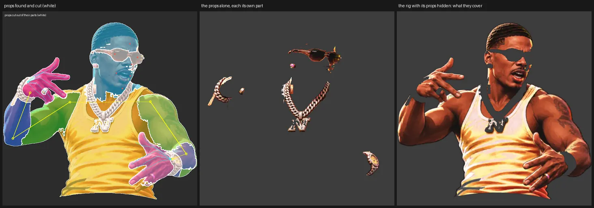
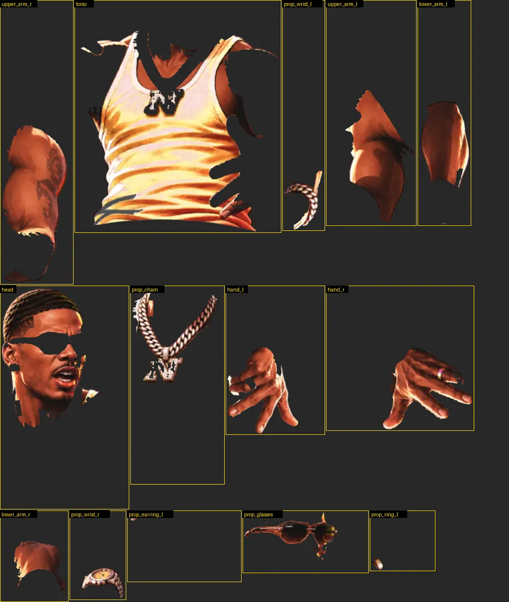

# Frame to rig — one animation frame to a rigged, skinned template character

> Status: designed + proof of the hard steps (2026-11-21); **F1 (frame + cut) built** (§12); **F2a
> (the fitted `templateRig`) and F4 (bending parts) built**, as-built notes in §4.6 / §4.7; **F2b
> (parts, sheet, 🦴 Create rig) built** (§12, 2026-11-22); F3 (the GPU fill) waits on RunPod; the
> other phases in §10. **🗺 From my sheet built** (§13, 2026-11-24): an artist's own sheet mapped to
> the template's parts, the same fit and skin.
> Owner tool: Invisible Rigger (`/rigger`, agent `invisible-rigger`), with the Atlas Maker
> (`services/atlas-tool`, agent `atlas-python-tools`) and the RunPod worker. Builds on:
> [rig-templates](rig-templates.md) (the templates, §5.3 MediaPipe, §6 the T6 art blueprint),
> [rig-2p5d](rig-2p5d.md) §4.7 (drawings by angle), [runpod-comfyui-backend](runpod-comfyui-backend.md).
> Proof scripts: `tools/frame-to-rig/` (not gates: they read the owner's frame, which is not in
> the repo). Pictures: `docs/design/frame-to-rig/`.

## 1. The ask

The owner, 2026-11-21: "take the first frame of the animation flipbook, so we have a split we can
animate, a sheet produced with the correctly named regions, and the regions already skinned to the
rig for animation." Art for templates is the slow part (T6's generated busts wait on a RunPod
top-up); a character that already exists as a Flipbook clip should become a template rig without
anyone cutting it by hand.

## 2. Verdict

**Build it, in the order of §10, and default to the best frame, not the first.** On the owner's
real frame (NellyAnimTest frame 0, Half body 3) the hard steps hold up:

- **Joints → cut → rig is exact and automatic.** MediaPipe's joints prompt SAM 2.1 (2–3 s on CPU
  for the whole character); the parts, placed on a skeleton fitted from the same joints and posed by
  engine-rig, redraw the frame at alpha IoU **0.998**, mean colour error **2.65 / 255**, every limb
  joint **0.0 px** from MediaPipe's (§8).
- **Filling what parts hide is the real work, and it is GPU work.** A quarter of the character
  (**61,408 px, 24.2%**, with the props cut out) is under another body part; 73% of that lies deeper
  than 8 px, past what a CPU fill can paint. Another 26,523 px are under the props, made only for a
  prop that swings or comes off. A masked inpaint **redraws the occluder** — given an arm-shaped hole, the model
  paints an arm back (measured twice, §8.4). Limbs fill well one part at a time; the torso behind
  the arms is the open case. Its model is Qwen-Image-Edit-2509 on RunPod; the account is unfunded,
  so this step waits for the owner (as T6 does), and the rig works meanwhile with CPU-filled seams.
- **Two routes for the art, one rig.** _Cut the frame_ keeps the frame's pixels. _Redraw, then cut_
  first has the edit model draw the character in the template's rest pose (arms down, facing the
  viewer), and cuts that: no foreshortening (forearms 0.93 against 0.27), no hand over the body,
  holes down to 17.9% and simple in shape — but the art is a redraw (klein kept the glasses, chain,
  watch and tattoo, and lost the painterly finish and the framing, §8.5). Either way the rig is posed
  like the frame by the frame's joints. Offer both; which one leads is decided by Qwen's run (§11).
- **The first frame is a median frame.** Frame 0 draws the right forearm at **0.27** of its length
  (pointing at the camera) and ranks 66th of 130; frames 111–114 have every limb in the picture
  plane and no hand over the body. A frame picker that scores the clip is cheap and is step 1.
- **Props are parts of their own.** The chain, the glasses, the watch, the bracelet, a ring and an
  earring are found (MediaPipe's segmenter has an "accessories" class), refined by SAM and cut out
  of the part under them, each on its own slot on the bone it rides (§4.3a): a pendant can swing,
  glasses can come off or be swapped, a re-skin changes the jewellery alone. All six were found on
  frame 0, the pendant only once SAM grew the chain; the hair was flagged as a possible hat for the
  author to confirm.
- **The face needs T6.** The template's face block needs closed eyes, brows and mouth shapes that
  one frame cannot have; NellyAnimTest also wears sunglasses, now a prop of its own, so what is
  under them (the eyes) is the face edits' to draw. The head ships as one image until then.

## 3. Licences (read 2026-11-21 from the model cards, LICENSE files and dataset pages)

| Use                | Model                                                      | Code · weights          | Catch                                                                                                                                          |
| ------------------ | ---------------------------------------------------------- | ----------------------- | ---------------------------------------------------------------------------------------------------------------------------------------------- |
| Joints             | MediaPipe Pose / Hand / Face Landmarker                    | Apache-2.0 · Apache-2.0 | already shipped in the Rigger (§5.3 of rig-templates)                                                                                          |
| Cut                | **SAM 2.1** hiera tiny / small (`facebook/sam2.1-hiera-*`) | Apache-2.0 · Apache-2.0 | none; in `transformers` ≥ 4.56. **Not SAM 3**: its custom "SAM License" lets Meta change the terms, with continued use as acceptance           |
| Props              | MediaPipe multiclass selfie segmenter                      | Apache-2.0 · Apache-2.0 | classes hair / body-skin / face-skin / clothes / accessories; trained on photos, so a painted hair-do may read as a hat                        |
| Fill               | **Qwen-Image-Edit-2509** (and 2511)                        | Apache-2.0 · Apache-2.0 | none; the T6 blueprint's model (20.4 GB fp8)                                                                                                   |
| Fill (local / alt) | FLUX.2 [klein] base 4B, klein 4B                           | Apache-2.0 · Apache-2.0 | the card allows commercial outputs; **the 9B kleins are non-commercial**; no BFL mask inpaint (ComfyUI's latent noise mask works on any model) |
| Fill (option)      | InstantX Qwen-Image-ControlNet-Inpainting                  | Apache-2.0 · Apache-2.0 | not tried                                                                                                                                      |
| Layers (R&D)       | Qwen-Image-Layered                                         | Apache-2.0 · Apache-2.0 | RGBA layers, count not semantic; the card does not say it completes what a layer hides                                                         |
| CPU seam fill      | OpenCV Telea inpaint                                       | Apache-2.0 (OpenCV)     | no model                                                                                                                                       |
| ✗ Refused          | LaMa big-lama                                              | Apache-2.0 · not stated | trained on Places2, offered "for academic research and education purposes"                                                                     |
| ✗ Refused          | FLUX.1-dev / Fill, PuLID, InsightFace, DWPose              | —                       | non-commercial (as before)                                                                                                                     |
| Runner             | ComfyUI                                                    | GPL-3.0                 | run as a service, never distributed; its outputs are not GPL                                                                                   |

The models' licences say nothing about the **input art**: the frame must be ours or the client's,
as for mockups (Director ground rule 6), and a recognisable real person needs their rights cleared.
The pipeline does not check either.

## 4. The pipeline

| #   | Step                                 | Automatic?                                                | Runs                                        |
| --- | ------------------------------------ | --------------------------------------------------------- | ------------------------------------------- |
| 1   | Pick a frame                         | yes — best score preselected; the author can pick another | browser (the track 🎥 Motion already makes) |
| 2   | Joints                               | yes; a missed or wrong joint is dragged                   | browser (MediaPipe, as 🎥 Motion)           |
| 3   | Cut into the template's parts        | yes; touch-up brush for a mislabelled patch               | atlas-tool, CPU                             |
| 3a  | Cut the props out, each its own part | yes; the author confirms one on top of the head (hat?)    | atlas-tool, CPU                             |
| 4   | Fill what each part hides            | yes, per part, with a retry per part; review by eye       | RunPod (GPU); CPU seam fill without it      |
| 5   | Pack a sheet, regions named by part  | yes                                                       | atlas-tool (Atlas Maker manifest)           |
| 6   | ＋ New rig from the template, fitted | yes                                                       | launcher (`templateRig` + a fit)            |
| 7   | Mesh and weight the bending parts    | yes, from the known joints                                | launcher (template `bend`)                  |

### 4.1 Pick a frame

Every frame of the clip is already tracked when 🎥 Motion reads it (`RiggerMotion.track`, face +
body + hands in one pass). Score each frame (`proof.py pick`):

- **Foreshortening** — each arm segment's drawn length over its length in MediaPipe's 3D world
  points, scaled by the shoulders (1 = in the picture plane). A part cut short stays short: the rig
  stretches it only by distorting the art.
- **Hands over the body or the face** — the share of the torso box and (×2) the face box the hand
  boxes cover: what is under a hand must be made (§4.4).
- **Found** — face, body, both hands; visibility of the six arm joints.

`score = mean(foreshortening) − ½ · cover − 0.5 (a joint under 0.8 visibility) − 0.2 · (3 − found)`.
On NellyAnimTest: frame 0 scores 0.69 (right forearm 0.27, cover 0.08), the clip's median; frame 114
scores 0.99 (every segment ≥ 0.94, no cover). 69% of its frames draw some segment under 0.6 of its
length, 52% have a hand over the body. The strip shows each frame with its score and the reason.

### 4.2 Joints

MediaPipe as the Rigger already runs it (pose 33 points with world points, hands 21, face 478). The
template's `_l` is the picture's left (the performer's right, pose 12 / 14 / 16); a hand goes to the
side of the nearer pose wrist (as `rigMotionHand.ts`). On a stylised character MediaPipe can miss
(rig-templates §5.3: Sintel 69 of 144 frames); the cut screen shows the joints and lets the author
drag one, so a miss costs a drag, not the character.

### 4.3 Cut

**SAM 2.1, prompted from the joints, one prompt per part**, then one partition (`proof.py segment`):

- Prompts: positive points along the part's bone (30 / 55 / 80% shoulder → elbow, three along the
  forearm, the hand's knuckles and finger joints, the face's nose / brow / forehead / chin and a
  point above the hairline), negative points on the neighbours (the next segment, the hand, the
  torso's middle, the face), and a box around the part's joints.
- Partition: a pixel inside the character's alpha goes to the **front-most** part (template draw
  order: hands, forearms, upper arms, `_r` over `_l`, head, torso) whose mask claims it; an unclaimed
  pixel goes to the part whose **capsule** (joints only) claims it most; a stray island joins the
  neighbour it touches most. Every pixel ends in exactly one part.
- **The neck is not prompted**: on a frame it is a sliver under the chin, often under a collar or
  a chain (NellyAnimTest: the neck prompt took the chain). It is cut by geometry instead, the head's
  and the torso's skin below the jaw and above the shoulders, so it turns on its own bone (§12 F2c).
- Hands are one image each: finger segments at 60–120 px are not cut reliably, and the template
  takes a whole hand on `hand_*` (rig-templates §3.5, "art with no segments works too"), made a
  mesh over the finger bones placed on the frame's fingers (§12 F2c).

### 4.3a Props — the chain, the glasses, the jewellery

A prop is worn, not grown: it moves with one bone but is not that bone's drawing. Cut into the head
or the torso, the glasses turn with the face but can never come off, and the chain nods with the
head. So each one is its own part (`proof.py props`):

1. **Find**: MediaPipe's multiclass selfie segmenter (CPU, 1.2 s here; class "others
   (accessories)") — each connected piece over 60 px is a candidate.
2. **Name it by where it sits on the joints**: over the eyes → `prop_glasses` on `face`, drawn
   before `hair_front`; by an ear → `prop_earring_*` on `head`; between the chin and the chest →
   `prop_chain` on `chest`, drawn before `neck` (the chin covers it when the head nods); at a wrist →
   `prop_wrist_*` on the forearm, drawn after that arm's last finger (a watch hides the wrist's seam);
   on a finger → `prop_ring_*` on the hand. One on top of the head is **not taken**: hair or a hat,
   the author says (here, the cornrows). Anything else is listed for the author to place.
3. **Refine with SAM 2.1**: a box around the piece (a chain's reaches down for its pendant) and
   points deep inside it; the prop is SAM's mask in the box plus the piece.
4. **Cut it out** of every part (props are drawn in front of what they sit on), and give it a slot
   of its own at create (§4.6): template rigs gain slots, never lose any, so every control and clip
   still plays.

**What a prop covers is made only if it is going to move.** A prop that rides its bone (glasses,
a watch) needs nothing under it; one that swings (a pendant, with a physics constraint) needs the
skin or cloth behind it; one that comes off or is swapped needs the whole of it (eyes behind
glasses). The fill step (§4.4) takes the author's choice per prop; the area is counted apart (§8.2).

### 4.4 Fill what each part hides

For each part, its **whole** shape: the visible cut plus what it continues into — a limb's capsule
(the visible half-width, round ends: the overlap a joint needs to bend without a gap), the torso's
hull through the shoulders and hips, the hand plus its wrist's round end — inside the character's
outline. Of the hidden pixels:

- **under a part drawn in front** — _occluded_, revealed when that part moves: **must be made**;
- **over a part drawn behind** — a joint's round end or pixels the cut gave the neighbour: the part
  is drawn on top there, so **the frame's own pixels** are right, and nothing is made.

What makes the occluded pixels (§8.4 measured why):

1. **One pass per part, the part alone** on a blank background, its occluded area grey and
   noise-masked, the visible pixels composited back afterwards so nothing visible changes. With the
   frame around the hole the model continues the occluder: it drew the arms back into the torso.
2. **Limbs** take it well: the hidden elbow end of an upper arm came back as arm.
3. **The torso does not**: its holes are arm- and hand-shaped, and a hole shaped like an arm is
   filled with an arm (klein drew sleeves and a hand). Two things to try with Qwen-Image-Edit, whose
   instruction following T6 already relies on: the torso alone with "the arms removed" as an
   unmasked edit, its result taken only inside the torso's occluded area; and the **redraw** route
   (§2), which leaves the torso only the strips behind the hanging arms. A re-pose edit used as a
   patch for the frame's torso does not work: the redraw is neither aligned with the frame nor
   painted like it (§8.5).
4. **Without the GPU** the occluded pixels are filled from the part's own by OpenCV Telea: right for
   the seam band (≤ 8 px, 27% of the area here), a smear across the rest. The rig is usable at once
   and the smears show only where a part moves off its place; the GPU pass replaces them later.

**The redraw route** runs the same steps 2–7 on the edit model's rest-pose drawing of the
character (one unmasked pass, `inpaint.py repose`). Its joints come from MediaPipe on the drawing;
the frame's joints still give the `frame` clip, so the rig ends in the frame's pose. It is the
remedy for a clip with no good frame (§4.1) and for a limb the frame foreshortens (§7).

### 4.5 Pack

Each part is written on a canvas **centred on its bone** and **turned back into the template's rest
pose** (the template's convention: an image centred on its bone, no offset, image-up = the bone's up
at setup), 1 px = 1 rig unit, at the template's scale (the frame's shoulder width → 280). The
canvases go to the Atlas Maker as one sheet named by part (`torso`, `head`, `upper_arm_l`, …), so
it is an ordinary project sheet (trimmed, optimised, versioned) and ＋ New rig attaches it by name.

### 4.6 ＋ New rig from the template, fitted to the frame

`templateRig(template, regions)` gains a **fit**:

- **Lengths, not directions.** Each chain bone keeps the template's direction and takes the frame's
  length (upper arm, forearm, the chest's height, the neck → head), scaled by the shoulders. Every
  template control and starter clip keys rotations against the same rest pose, so all of them keep
  working; the character's own proportions are kept (NellyAnimTest's arms are 1.17–1.24× the
  template's).
- **The frame is a clip, not the setup.** The frame's pose is keyed at t = 0 of a `frame` animation
  (one rotation per bone: the spine to the hips → shoulders line, the chest to the shoulder line, the
  neck and head to the eyes, each arm segment to its joints). A setup pose equal to the frame would
  make every clip and control play from a raised arm.
- **What carries a length must be refitted with it**: the `shorten` controls move the next joint by
  the template's own length (`per: -n.y`), and the control bones, poles and depths sit at template
  places. The fit rewrites them (phase F2).
- The face block keeps its own layout: NellyAnimTest's eyes are 80 apart, the block's 90, so each
  eye lands 5 px off (the eyes' middle exactly).
- **Props are extra slots**: `{name, bone, before | after}` per prop, its image centred on that
  bone like any part. Not a template part (a template stays the contract every rig of it shares); 📐
  Save as template keeps them as optional parts if the author wants them on every character.

**As built (F2a, 2026-11-21).** `templateRig(t, regions, fit?)` (`rigTemplates.ts`), the fit in
`rigTemplateFit.ts`: `fit = { bones: {name: {x, y}}, frame?: {bone: {rotate, scaleY?}}, props?:
[{name, bone, before | after}], bends?: {part: {bones, ramp, grid?, covers?}} }`.

- **What follows a fitted bone** (by its fitted / template length): every translate drive on it (a
  limb's shortening brings the next joint in by its fitted length; Body side-on's joints) and the
  translate keys of a template's own timeline clips, bezier values included; each control bone (the
  rig-controls names, spaces `hand_ik_l_<space>` included) keeps its place on what it marks; a pole's
  depth scales with the limb above its joint (NellyAnimTest-like arms: the elbow poles −80 → −99.4 /
  −93.4). Image bones sit on their joint at (0, 0) and follow untouched.
- **Refused, with the reason** (a 400 from `/api/rigger/new` and `/upload`, which read the fit
  strictly): an unknown bone, slot, part or field, a value that is not a finite number, a bone turned
  or reversed (0.01° of slack for float noise), one that sits on its parent (no length), one longer
  than 100,000 (its world sums would overflow), a control bone, a scale of 0, a bend the bend
  contract refuses.
- **Props** are slots and optional parts of the fitted template, and join every depth control and 3D
  layer their neighbour is in: the watch and the ring go behind the body with the left arm, the
  glasses and the earring move in depth with the head. A prop without art is listed missing, never
  needed, and its slot starts empty.
- **Nothing new ships** (rule 8): the rig is an ordinary `.irig`. The fit is kept in the bundle's
  `template.json` (`{id, version, fit}`) and `/api/rigger/template` answers the fitted template
  (`sidecarTemplate`), so the Controls, the motion import's solve and a 3D import's first `rig3d.json`
  use the fitted lengths. A kept fit that no longer applies leaves the template as it is (logged).
- **The control layer and 3D IK** (T12a, K4): ＋ New rig's `controls.json` and the template's
  constraints come from the fitted template, so they bind to the fitted bones and the prop slots.
  The layer itself is the template's own. The rings are sized to their joint, and a fit lengthens
  limbs without thickening them. The picker's places are fractions of its board. Its IK squares and
  poles are the control bones above, which keep their place on what they mark. No built-in carries
  translate limits or constraints. A 3D IK (`rig3d.json` `ik`) is made on the rig after it exists,
  and reads the irig's fitted bones and the fitted pole depths. On a fitted arm, K4's own solve
  keeps the hand on the fitted wrist with the IK on, and reaches a moved control with the fitted
  lengths (the gate's `ik3d`).
- **Not yet**: the motion map's shoulder scale (`rig: 280`) assumes the fit keeps the shoulder
  line, as the proof's does (F2b's does: §12); a template's own draw-order keys are not re-indexed
  around props (no built-in has any). The frame-pose alpha IoU of the F2 gate is F2b's (§12).
- **Gate** `tools/rigger-spike/frame-fit.mjs` (headless, engine-rig): a synthetic performer with
  NellyAnimTest's proportions (lengths 0.33–1.3×, every chain joint turned) → its joints → a fit →
  the `frame` clip poses every joint **0.0000** rig units off (Half body 14 joints, Full body 18, Bust
  7); every control at min / rest / max and every starter clip pose finite on the three fitted
  templates (814, 255 and 457 poses, plus the store's pose check); a shortening's next joint lands
  within 0.005 of 0.3 × its fitted length; the 8 / 14 control bones sit 0.0000 from what they mark;
  NellyAnimTest's six props draw where §8.1a puts them; 21 bad fits refused; T12a's control layer
  binds to all three fitted rigs; K4's 3D IK reaches with the fitted arm (10⁻¹² off its length);
  a mutant planted per guard (27), each turning its check red.

### 4.6a ⤢ Fit an existing rig to a capture

A rig made from a template keeps the template's limb lengths; a performer's arms are longer, so 📍
Follow positions (rig-templates §5.8) reaches the tracked wrists with the elbows in the wrong places.
**⤢ Fit rig to the capture** in the 🎥 Motion row refits the open rig to the capture picked there
(`rigCaptureFit.ts`):

- **What is measured.** The lengths following positions reaches with: per limb of the template's
  positions map, the upper bone's (its lower bone's offset) and the lower bone's (its end's offset).
  Per frame where both ends are seen (visibility ≥ 0.5): the length in the picture on the Reference's
  line-up with the tracker's depth between the ends at the frame's pixels per metre — the very point
  the follow aims each joint at. The median over the clip, both sides pooled (one length for both
  arms). Not the tracker's 3D points alone: against their own shoulders they put the arms 20–35%
  shorter than the picture does (NellyAnimTest and the NASA clip), and a rig fitted to them still
  missed NellyAnimTest's elbows by 42.7 (median), against 11.5 this way. Not the picture alone: a
  limb pointing at the camera draws short. The lengths are the overlay's, so a Reference scaled by
  hand fits limbs to the picture where it is drawn.
- **What follows a length** — the rules of `fitLengths` (§4.6), on the rig's own data: the limb
  bones' offsets along their own directions; every animation's translate keys on them, bezier
  values too, except the tracks a 3D clip's bake owns (baked again in the page, and by the save);
  the control bones, each kept on what it marks; in `rig3d.json` the poles' depths and the 3D clips'
  authored translate and depth keys.
- **The art stretches** (owner's choice, 2026-11-21; at most ×1.5 either way since 2026-11-22, §12
  F2c): the limb's image bone takes the ratio on its
  setup scale along the limb, so every point of the art keeps its place along and across it and no
  gap opens at a joint; foreshortening keys stay factors of it, and the 3D bake keeps it. Art drawn
  in the limb bone's own frame (a rig without image bones) is stretched there: a region's place and
  size, a vertex attachment's vertices, the vertices any mesh weights to the bone, their deform keys.
  A bend on the image bones (§4.7) stretches with them, its weights unchanged.
- **One undo step** in the page. The template the page drives the rig with follows the rig's limb
  lengths from then on (an undo too: `templateOnRig`). **Nothing else is written**: the save writes
  the `.irig` as any save does, and `GET /api/rigger/template?dir=…&stem=…` answers the template on
  the limb lengths of the **saved** `.irig`, derived on every read (`sidecarOnRig`). A second stored
  copy of the lengths could only drift: a stale tab's "overwrite with mine", a 🕘 restore, a tab
  closed after its save each rewrite the `.irig` alone. The rest of a frame-made rig's fit (its pose,
  props, bends) is kept from its `template.json`; a rig that does not read, or whose limbs do not fit
  the template, reads the template as stored.
- **Measured** on NellyAnimTest (`invisible_wall/rocketreskintest1`, read-only; Half body, 📍 Follow
  positions, 130 frames): upper arms 190 → 243.9, forearms 170 → 224.9; elbows **54.8 → 11.5** rig
  units (median; p90 80.8 → 29.0), wrists 11.3 → 11.3, shoulders 7.1 → 7.2. The NASA interview (384
  frames): elbows 31.2 → 19.1 (p90 70.0 → 45.4). What is left is the tracker's: its depth spreads a
  length 18–31% over a real clip.
- **Gates** `tools/rigger-spike/capture-fit.mjs` (headless, engine-rig: a synthetic performer with
  arms of known lengths, its forearm toward the camera most of the clip → lengths within 0.5, the
  Follow-positions elbows 43.1 → 1.5 off, as near as the wrists; art, controls, keys, a flat rig, the
  3D bake; 25 mutants) and `capture-fit-browser.mjs` (the shipped page: the button, a fit after an
  import without tracking again, undo and redo, the rig opened again on its saved lengths);
  `check-rigger-writes.ts` for the route (read on the saved lengths, a kept fit, a rig back on the
  template's, one that does not read; nothing written).

### 4.7 Mesh and weight

Half body's segments are rigid regions with round ends (the cut makes the ends), which is the
template's model. What bends: the torso (spine and chest: lean, twist, breath) and, as an option,
an arm as one piece (sleeves, where a round end shows). Both use the template's existing `bend`
(a grid weighted to bones by their place on the image) with the anchors taken **from the frame's
joints**, which the cut knows exactly per character, and a weight that ramps along the limb's axis
across the joint (its width = the limb's width there). That is a one-dimensional blend with known
joints, not the general skinning problem of open item 3 (the proximity skinner), which stays open.

**As built (F4, 2026-11-21).** A bend with `ramp` (`RigTemplateBend.ramp`, set by the fit's `bends`)
weights its grid along the chain of its bones: past each joint the next bone takes over, its share
ramping **linearly** across the limb's width there, so away from a joint a vertex rides one bone
exactly. Linear, not eased: a blend of two turns folds the inside of a bend once the share's slope ×
the limb's half width × sin(bend) passes cos²(bend / 2) — at 90° for a linear ramp as wide as the
limb, at about 67° for an eased one (measured: eased folded from 75°, linear not before 90°). The
grid gains rows across each ramp (its ends, quarters and middle) so the mesh bends where the weights
do: without them the 35° elbow cracked 3 px. Bend grids may now be up to 32 (a fitted bend defaults
to 3 × 32). `covers` names the parts a one piece stands in for: the one-piece arm's forearm is listed
missing, not needed.

- **Torso** on hip, spine and the chest's image bone, joints at the waist and the chest: the lean
  bends it at the waist with the hem on the hips (spine + chest alone would swing the hem with the
  lean), twist and breath bend it at the chest, and Body side-on and a 3D turn still narrow it there.
- **Arm as one piece** (a sleeve) on the upper arm's and forearm's image bones, so a shortening still
  shortens each half.


Measured by the gate (Half body fitted as above, the left arm 35 units wide; "cracks" is §8.3's 9 px
closing kept inside the bent limb's outline, "gap" every pixel of that outline nothing covers,
"drift" how far the part strays from the bone it should ride):

| Pose                        | Ramp mesh                                        | Proximity skinner, same mesh         | Rigid parts cut at the joint |
| --------------------------- | ------------------------------------------------ | ------------------------------------ | ---------------------------- |
| Lean 20°, twist 12°, breath | 0 cracks, 0 folds; torso top drift 5.9, hem 21.2 | top 49.0, hem 43.5                   | top 0, hem 126.8             |
| Elbow 35° (the proof's)     | **0 cracks**, gap 112 px, 0 folds, ends 0.00     | 0 cracks, gap 2,308, ends drift 11.2 | 36 cracks, gap 354           |
| Elbow 60°                   | 4 cracks, gap 299, 0 folds                       | 0 cracks, gap 4,323, ends 18.7       | 21 cracks, gap 605           |
| Elbow 75°                   | 29 cracks, gap 418, 0 folds                      | 4 cracks, gap 5,380, ends 22.7       | 11 cracks, gap 744           |
| Elbow 90°                   | 7 cracks, gap 519, 2 folds                       | 1 crack, gap 6,143, ends 26.4        | 7 cracks, gap 912            |
| Elbow 120°                  | 0 cracks, gap 1,130, 2 folds                     | 7 cracks, gap 6,818, ends 32.4       | 2 cracks, gap 1,213          |

The one-piece arm bends without a crack through the proof's bent pose, pinches the inside of the
elbow a little past 60° and folds past 75° (any blend of two turns does), and loses a third to a half
of what rigid parts cut at the joint lose, to 90°. The proximity skinner bleeds weight along the whole limb:
its far ends drift 11–32 units off their bones. Past about 90° a sleeve wants a drawn bent pose (an
image swap, F5's kind of edit); rigid parts with round ends (the filled ones) cover any bend.

## 5. Where it runs, and the data

```
Flipbook clip  <c>/<p>/clips/<id>.clip.json → frame region in its sheet (manifests/…)
   │  browser: 🎥 Motion's track (all frames) → scores → chosen frame + joints (+ author's drags)
   ▼
atlas-tool job  rig-from-frame (CPU)                       <c>/<p>/rig-from-frame/<job>/
   frame.png · joints.json · cut (SAM 2.1, onnxruntime) · props (MediaPipe segmenter, 16 MB)
   · masks · whole/occluded · report.json
   │  fill (queued, RunPod serverless; ONE job per character: every part's pass, or the redraw)
   ▼
parts/<part>.png + prop_<name>.png (canvas on its bone) → Atlas Maker sheet + manifest (named)
   │  manifests/atlas_manifest_<Name>_parts.json · sheets/<Name>_parts/…
   ▼
launcher  POST /api/rigger/new { manifestKey, templateId, fit }   spines/<name>/ .irig + template.json
```

- **atlas-tool, not the browser, cuts**: the job also writes the parts and the sheet, and SAM 2.1
  small is ~180 MB of weights a page would load per session. atlas-tool today is Pillow only; it
  gains `numpy`, `opencv-python-headless` and `onnxruntime` (no torch), with the SAM 2.1 export
  checked against the torch reference measured here (phase F1).
- **The GPU only fills**, so a cut can be made and reviewed with the RunPod account empty.
- **Rule 8: nothing new ships.** The parts are an ordinary sheet and the rig an ordinary irig bundle,
  exported by the chain rigs already travel. `rig-from-frame/<job>/` is authoring scratch (the
  T6 cutter's output is the same kind) and is never baked.

## 6. UI

In the Rigger, **＋ New rig** → template → art: **From a Flipbook frame** (beside a sheet and
uploaded images):

1. Pick the clip (the picker 🎥 Motion uses). The track runs once; a strip of frames shows each
   score and why (a short limb, a hand over the body); the best is selected.
2. **✂ Cut** (seconds): the parts over the frame in their colours, the joints draggable, a brush to
   move a patch to another part, the template parts it cannot make listed (face shapes, hand poses).
   Each prop is listed with its name and bone, ✓ / ✗, and whether it rides, swings or comes off.
3. **🎨 Fill** (queued GPU job, status like a generation): each part whole, its made pixels
   outlined; ↻ per part (new seed). With the GPU down the CPU fill is used and marked.
4. **Create rig**: the sheet is written, the rig made fitted, the `frame` clip added; the report
   lists what is missing, as a template create does today.

The Flipbook gets **🦴 Rig from this frame**, which opens the Rigger with the clip and frame chosen
(a full-page navigation, not an iframe).

## 7. Failure modes

| Case                                   | What happens                                                                                                                                  | Answer                                                                                               |
| -------------------------------------- | --------------------------------------------------------------------------------------------------------------------------------------------- | ---------------------------------------------------------------------------------------------------- |
| A limb toward the camera               | it is cut short (frame 0's right forearm 0.27); its joints nearly meet, so the prompts cannot split it (SAM gave half of it to the upper arm) | the picker avoids it; else the redraw route (§4.4)                                                   |
| A hand over the body or the face       | a large occluded area (the torso's 39k px here)                                                                                               | the fill; over the face, the face block's parts cannot be cut — pick another frame                   |
| Props on the body                      | the segmenter missed the pendant (read as clothes) and the ring on the right hand; SAM's glasses box took a few hairline specks               | SAM grows a found piece (the pendant came with the chain); the brush adds or removes a prop's pixels |
| Hair read as a hat                     | the segmenter calls a painted hair-do an accessory                                                                                            | never taken automatically: the author confirms a prop on top of the head                             |
| Sunglasses, a mask, a hat over eyes    | cut out as a prop (§4.3a); behind it there are no eyes to cut                                                                                 | the prop rides the face and the eyes stay hidden, or T6 edits draw eyes if it comes off (§11)        |
| Loose clothing, long hair, a tail      | one image spans several bones; hair behind the shoulders is not split                                                                         | a `bend` mesh on the bones it spans; `hair_back` / `hair_front` by hand for now                      |
| A ¾ or side frame                      | the template is drawn facing the viewer; one angle only                                                                                       | the frame is the drawing for its angle; others from Qwen turn passes (rig-2p5d §4.7, T6)             |
| Fingers                                | segments too small to cut                                                                                                                     | whole hands; drawn poses (open, fist, point, thumbs up) as edit passes, optional                     |
| MediaPipe misses or swaps a joint      | the cut follows it                                                                                                                            | drag the joint; the cut reruns in seconds                                                            |
| Masked inpaint                         | the model redraws the occluder into a hole shaped like it                                                                                     | part-alone passes; the torso is the open case (§4.4)                                                 |
| A filled part drawn over its neighbour | in the frame pose the filled parts differ from the frame by 4.4 / 255 on average                                                              | only the occluded pixels are made; the frame's own pixels elsewhere                                  |

## 8. The proof (NellyAnimTest frame 0, `invisible_wall/rocketreskintest1`, read-only)

720 × 720, the character 253,279 px (the clip's frames carry alpha). Track: the 🎥 Motion capture of
the whole clip made for §5.8 of rig-templates (the Rigger's own bundle in Chrome). Template: Half
body 3 built by `templateRig` and posed by engine-rig (`tools/frame-to-rig/rig-pose.mjs`). Run:

```
python tools/frame-to-rig/proof.py pick    --track cap.json --out out
node   tools/frame-to-rig/rig-pose.mjs --geometry geometry.json
python tools/frame-to-rig/proof.py segment --frame frame0.png --track t0.json --out out --models tiny,small
python tools/frame-to-rig/proof.py props   --out out --geometry geometry.json --segmenter selfie_multiclass_256x256.tflite
python tools/frame-to-rig/proof.py holes   --out out --geometry geometry.json
python tools/frame-to-rig/proof.py parts   --out out --geometry geometry.json
node   tools/frame-to-rig/rig-pose.mjs --fit out/fit.json out/posed.json
python tools/frame-to-rig/proof.py compose --out out --posed out/posed.json
python tools/frame-to-rig/inpaint.py inputs|graph|run|merge|repose --out out --model qwen|klein
python tools/frame-to-rig/track.py --image still.png --out track.json [--bg 255]   # a still the page never tracked
```

Python: numpy, opencv-python-headless, pillow, torch (CPU) + torchvision, transformers ≥ 4.56,
mediapipe (the segmenter from MediaPipe's model storage, `selfie_multiclass_256x256`, float32).

### 8.1 Cut — steps 2–3 on CPU


SAM 2.1 through `transformers` 5.24 on torch 2.15 CPU (a 22-thread laptop): **tiny 1.9–3.0 s, small
2.0–3.1 s** for the image and all eight prompts. Left to the capsule fallback: tiny 19%, small 15%
of the character (mostly edges between parts). IoU per part:

| Part                    | SAM tiny vs small | small vs joints only | Note                                                              |
| ----------------------- | ----------------- | -------------------- | ----------------------------------------------------------------- |
| torso                   | 0.925             | 0.845                | the chain and pendant stay on it                                  |
| head                    | 0.940             | 0.932                | hair, ear, the neck's visible skin                                |
| upper arms              | 0.928 / 0.920     | 0.80 / 0.76          | joints-only cuts the shoulder on a circle, SAM on the outline     |
| forearm `_l`            | 0.960             | 0.817                | splits at the bracelet                                            |
| hand `_l`               | 0.978             | 0.871                | fingers whole                                                     |
| hand `_r`, forearm `_r` | 0.73 / 0.73       | 0.47 / 0.49          | the foreshortened arm: SAM gave half the forearm to the upper arm |

Recommendation: **small** (same cost, steadier on the hands), with the joints-only capsules as the
fallback the partition already uses. Neither needs a GPU.

### 8.1a Props



| Prop             | Segmenter px | With SAM | Rides         | Drawn                           | Taken from                  |
| ---------------- | ------------ | -------- | ------------- | ------------------------------- | --------------------------- |
| `prop_chain`     | 6,871        | 9,978    | `chest`       | before `neck`                   | torso 8,398, head (neck)    |
| `prop_glasses`   | 5,323        | 6,103    | `face`        | before `hair_front`             | head                        |
| `prop_wrist_l`   | 2,758        | 3,230    | `lower_arm_l` | after the left arm's last slot  | forearm 2,650, hand         |
| `prop_wrist_r`   | 2,184        | 2,784    | `lower_arm_r` | after the right arm's last slot | hand 1,778, forearm 1,006   |
| `prop_ring_l`    | 169          | 367      | `hand_l`      | after the left arm's last slot  | hand                        |
| `prop_earring_l` | 165          | 299      | `head`        | before `hair_front`             | head                        |
| not taken        | 7,371        | —        | —             | —                               | the cornrows, read as a hat |

The segmenter took 1.2 s on CPU. It scored the pendant as clothing; SAM, prompted from the chain
with its box reaching down, brought the pendant in. It missed the ring on the right hand (pink in the
overlay) and SAM's glasses box took a few specks of the hairline: the brush's work. Props drawn
over their hosts leave the frame unchanged (alpha IoU 0.998, colour error 2.89).

### 8.2 Holes — what step 4 must cover


With the props cut out (the numbers without props: 64,816 px, 25.6%, all under body parts):

| Part           | Visible                   | Under body parts — **must be made** | Under props — if the prop moves | Seam band ≤ 8 px | Deeper | Deepest | Under                              |
| -------------- | ------------------------- | ----------------------------------- | ------------------------------- | ---------------- | ------ | ------- | ---------------------------------- |
| torso          | 96,872                    | **39,142** (27% of the whole torso) | 9,586 (the chain)               | 17,643           | 31,085 | 72 px   | upper arms 24.8k, right hand 13.6k |
| upper arm `_l` | 21,686                    | **10,620** (30%)                    | 6                               | 2,171            | 8,455  | 83 px   | its forearm 9.0k, hand 1.6k        |
| upper arm `_r` | 26,525                    | **5,576** (16%)                     | 1,696 (the watch)               | 2,101            | 5,171  | 41 px   | its forearm 6.3k                   |
| forearm `_l`   | 14,195                    | **3,356** (16%)                     | 3,230 (the bracelet)            | 1,195            | 5,391  | 53 px   | its hand                           |
| forearm `_r`   | 6,049                     | **2,714** (22%)                     | 2,383 (the watch)               | 1,002            | 4,095  | 51 px   | its hand                           |
| head           | 35,096                    | 0                                   | 6,064 (glasses, earring)        | 3,652            | 2,412  | 25 px   | —                                  |
| hands          | 30,095                    | 0                                   | 3,558 (watch, bracelet, ring)   | 2,068            | 1,490  | 19 px   | —                                  |
| **All**        | 230,518 + 22,761 in props | **61,408 (24.2%)**                  | **26,523**                      | 29,832           | 58,099 |         |                                    |

Besides these, 11,160 px of joint ends lie over the part behind and take the frame's own pixels.

### 8.3 Rig — step 6, posed through engine-rig


The sheet, every region named as the template and the props name it (each canvas centred on its
bone and turned to the rest pose; the Atlas Maker trims the empty margins when it packs):



With the six props on their own slots (14 attachments). Fit: 0.942 rig units per px (shoulders 298 px → 280). Fitted against the template: upper arms 236 /
222 (template 190), left forearm 203 (170), right forearm 56 (foreshortened, 3D says 0.27 of it),
chest 185 (150), neck → head 52 (40).

| Check (engine-rig quads drawn over the frame)                 | Visible parts only | CPU-filled parts |
| ------------------------------------------------------------- | ------------------ | ---------------- |
| Shoulders, elbows, wrists, the eyes' middle vs MediaPipe      | 0.0 px             | 0.0 px           |
| Each eye (the face block's 90 against the frame's 80)         | 5.15 px            | 5.15 px          |
| The frame pose: alpha IoU / mean colour error                 | 0.998 / 2.89       | 0.991 / 4.39     |
| A bent pose (every arm joint 25–35°, head 12°): cracks ≤ 9 px | 1,582 px           | 408 px           |

At rest (arms hanging) the visible-only parts show the torso's holes under the shoulders and the
forearm stub; the CPU fill closes the cracks but smears every interior — hence §4.4's GPU pass. The
seven required parts the rig reports missing are all the face block's (closed eyelids, neutral brows,
mouth rest / A / O): T6's edits, not this pipeline.

### 8.4 Fill — step 4

RunPod is unfunded, so the Qwen-Image-Edit-2509 graphs are prepared, not run (`inpaint.py graph
--model qwen` writes one API graph per part; ComfyUI core nodes only: `TextEncodeQwenImageEditPlus`,
`SetLatentNoiseMask`, `ImageCompositeMasked`, the T6 blueprint's sampler settings). As a stand-in,
**FLUX.2 [klein] base 4B** (Apache-2.0) ran on the owner's local ComfyUI (RTX 4070 Laptop, 8 GB,
shared with other apps):


| Pass                             | Result                                                          | Time                                                      |
| -------------------------------- | --------------------------------------------------------------- | --------------------------------------------------------- |
| Torso, the frame around the hole | **drew both arms and the hand back** into the hole              | 146 s (cold)                                              |
| Torso, the part alone            | **drew sleeves and a hand** — the holes are arm-shaped          | 69 s (warm)                                               |
| Upper arm `_l`, the part alone   | the hidden elbow end came back as arm (with an invented tattoo) | 4,050 s (VRAM shared with other apps; not representative) |
| Re-pose (arms down, whole frame) | a clean rest-pose drawing, §8.5                                 | 111 s (warm)                                              |

Both torso passes said "Do not draw arms, hands or fingers"; klein 4B ignored it. Hence part-alone
passes for limbs, the open torso case (§4.4) and Qwen-Image-Edit as the default model.

### 8.5 Redraw, then cut


One unmasked klein base 4B pass ("the same character standing with both arms hanging straight down
… same character, face, glasses, jewellery, clothing, tattoos, colours, art style, size and
framing", 111 s). It kept the glasses, the chain and pendant, the bracelet, the watch and the arm
tattoo; it **did not keep** the framing (it zoomed out to mid-thigh) or the finish (flatter, cleaner
line work than the frame's painting). MediaPipe in Python with the Rigger's own models found the
face, body and both hands on it (on frame 0 the same script agrees with the page's track within
1–7 px, the right elbow 23). The same cut, holes, fit and engine-rig check:

| On the redraw (1024², character 368,918 px)    | Redraw                                      | Frame 0 (§8.2–8.3)                 |
| ---------------------------------------------- | ------------------------------------------- | ---------------------------------- |
| Arm segments' drawn / 3D length                | 0.93–1.23                                   | 0.27–1.05                          |
| Must be made                                   | 65,988 (17.9%)                              | 64,816 (25.6%)                     |
| … of it in the arms                            | 15,808 (joint ends)                         | 25,674 (behind forearms and hands) |
| … of it the torso                              | 50,180 (the strips behind the hanging arms) | 39,142                             |
| Seam band / deeper                             | 22% / 78%                                   | 27% / 73%                          |
| Joints vs MediaPipe; each eye                  | 0.0 px; 10.0 px                             | 0.0 px; 5.15 px                    |
| Its own pose redrawn: alpha IoU / colour error | 1.000 / 3.96                                | 0.998 / 2.65                       |
| Bent pose cracks, visible / CPU-filled         | 1,443 / 660 px                              | 1,927 / 443 px                     |

SAM left 36% of the redraw to the capsules: the jeans below the waist, which no Half body prompt
names (the template's `pelvis` is optional). The torso's sides behind the arms must be made in any
pose (they show whenever an arm lifts): the redraw shrinks the arms' holes, not the torso's.

### 8.6 Run the GPU half when RunPod is funded

The same model as T6, so one transfer serves both:

1. Top up RunPod; `/comfyui` → What's installed → transfer
   `qwen_image_edit_2509_fp8_e4m3fn.safetensors` (the URL is in
   `services/atlas-tool/blueprints_src/qwen_bust_face_variant/blueprint.json` → `models`) and check
   `qwen_2.5_vl_7b_fp8_scaled` and `qwen_image_vae` are on the volume.
2. Start an R&D pod; set `COMFY=https://<pod>-8188.proxy.runpod.net`.
3. `python tools/frame-to-rig/inpaint.py inputs --out out`, then `graph --model qwen`, then
   `run --model qwen --comfy $COMFY`, then `repose --model qwen --run --comfy $COMFY`.
4. `inpaint.py merge --out out --model qwen`, `proof.py parts`, `rig-pose.mjs --fit`,
   `proof.py compose`: the `made-qwen` row joins the table in §8.3 and the pictures.
5. Stop the pod.

## 9. Cost per character

- **CPU (atlas-tool):** the cut 2–3 s here, perhaps 5–15 s on a shared Railway vCPU; holes, parts
  and packing under a second each.
- **GPU (RunPod serverless, Qwen-Image-Edit-2509 fp8, ~1 MP, 20 steps):** about five passes (the
  torso, two upper arms, two forearms; the redraw route adds one). The fleet measured Qwen-Image at ~15 s warm and 130–200 s
  cold on the network volume (status/comfyui §16); an edit reads the reference too, so ~20–40 s a
  pass. One job per character loads the model once: **~3–6 GPU-minutes, ≈ $0.04–0.10** at
  $0.70–1.00/h; three retries per part stay under $0.30.
- **Optional:** the face block from T6's twelve edits (+~5 min), four hand poses per hand (+~4 min),
  two to four turn drawings for 2.5D (+~2 min).

## 10. Build plan

| Phase                             | Size | Delivers                                                                                                                                                                                                                                                                                                          | Gate                                                                                                                                 |
| --------------------------------- | ---- | ----------------------------------------------------------------------------------------------------------------------------------------------------------------------------------------------------------------------------------------------------------------------------------------------------------------- | ------------------------------------------------------------------------------------------------------------------------------------ |
| **F1 — Frame + cut**              | M    | the scored frame strip from 🎥 Motion's track; atlas-tool `rig-from-frame` cut job (SAM 2.1 small via onnxruntime, prompts, partition, capsule fallback) and its props step (the multiclass segmenter, naming by joints, SAM growth); the cut screen (parts and props, draggable joints, a brush, ✓ / ✗ per prop) | the ONNX cut against this proof's torch cut on a committed CC-BY frame (IoU per part); the score on fixed tracks                     |
| **F2 — Parts, sheet, fitted rig** | M    | whole / occluded / overlap, canvases on bones turned to rest, CPU seam fill, Atlas Maker manifest; `templateRig` with a fit (lengths, the drives and control bones that carry lengths), the `frame` clip                                                                                                          | this proof's engine-rig check as a spike: joints ≤ 0.5 px, frame-pose alpha IoU ≥ 0.99, every template control and clip poses finite |
| **F3 — Fill on the GPU**          | M    | a `qwen_part_fill` blueprint (part-alone masked pass; the rest-pose redraw), one serverless job per character, the review screen with ↻ per part, the redraw route as a choice; CPU fill as the fallback                                                                                                          | blocked on RunPod funding: §8.6 on NellyAnimTest, judged by eye; a fixed fake ComfyUI for the job's plumbing                         |
| **F4 — Bending parts**            | S    | torso `bend` mesh on spine + chest, optional one-piece arm, anchors and axis-ramp weights from the joints                                                                                                                                                                                                         | a lean and a bent elbow with no crack, through engine-rig                                                                            |
| **F5 — Face, hands, angles**      | M–L  | T6's face edits on the cut head (mouth shapes, closed eyes, brows), hand poses, turn drawings (rig-2p5d §4.7); props over the eyes per §11                                                                                                                                                                        | a talk loop and a blink on a frame-made rig                                                                                          |
| **F6 — Entry points + docs**      | S    | 🦴 Rig from this frame in the Flipbook; `docs/tools/rigger.md` section                                                                                                                                                                                                                                            | docs-keeper audit                                                                                                                    |

F1 and F2 need no GPU and deliver a usable rig (CPU-filled seams). F3 waits on the RunPod top-up,
like T6; F5 needs F3's GPU path.

## 11. Open questions for the owner

1. **Default frame** — the best-scoring frame (recommended), or always the first?
2. **Which art route leads** — cut the frame (its own pixels; holes behind hands and forearms) or
   redraw in the rest pose, then cut (whole limbs; the art is the model's redraw)? Recommended:
   decide on Qwen-Image-Edit's run of both (§8.6), on NellyAnimTest and one more clip; offer both.
3. **Fill model** — Qwen-Image-Edit-2509 on RunPod (recommended; ~$0.10 a character; needs the
   top-up and the 20 GB model on the volume, which T6 needs too), or FLUX.2 klein base 4B (runs on
   an 8 GB card, but did not follow "no arms" in §8.4)?
4. **Proportions** — the character's own limb lengths on the template's skeleton (recommended), or
   the template's lengths with the art squeezed to fit?
5. **Props** — which ones swing (a pendant on a physics constraint, so what it covers is made) and
   which can come off (glasses: the eyes behind them are drawn, which changes the look)? Default
   proposed: everything rides its bone and nothing under it is made until the author ticks it.
6. **A foreshortened limb** — take the redraw route for that character, or require a frame without one?
7. **The face** — run T6's twelve face edits on every frame-made rig (+~5 GPU-min), or leave the
   face still until asked?

## 12. As built

### F1 — Frame + cut (2026-11-21)

**Where it runs.**

- **Browser.** `$lib/rigFrameScore.ts` (in `vendor/rigger-motion.js` as `RiggerMotion.scoreFrames`)
  scores the track 🎥 Motion's tracker makes (§4.1). The Rigger's ＋ New rig → **🎞 From a
  Flipbook frame** screen (`static/rigger/view.html`) shows the strip, the draggable joints, the cut
  over the frame, the brush and the props list; the tool guide is `docs/tools/rigger.md`.
- **Launcher.** `POST /api/rigger/from-frame` resolves the clip frame to its sheet page, its region
  and the clip's canvas — the largest untrimmed frame, as `clipFrames` draws every frame, so the
  track's normalised points land on the cut's pixels — and the template to its slots
  (`$lib/server/rigFromFrame.ts`), then calls atlas-tool with an `api` launch token.
  `POST /api/rigger/from-frame/edits` keeps the brushed label map (refused unless it is the frame's
  size, keeps the character's outline and names only the cut's parts; stored as 8-bit grey) and the
  props' ✓ / ✗ and motion, compare-and-swap on `cut.json`.
- **atlas-tool.** `POST /rig-from-frame` → `rig_from_frame.py`, inline like `/lipsync`, one cut at a
  time per process; the frame's SAM features are kept, so a re-cut after a joint drag runs the
  prompts alone.

**What a cut writes** to `<client>/<project>/rig-from-frame/<job>/` (authoring scratch, never
baked): `frame.png` (the frame at full size, with alpha), `track.json` (the joints as cut, drags
included), `labels.png` (8-bit: each pixel the index of its part or prop in `cut.json`'s `names`,
255 outside the character — the masks per part as one image, so a pixel is in exactly one part and
the brush edits one thing), `overlay.png` and `cut.json` (`names`; `parts` with their pixels; `props`
`{name, bone, before | after, host, px, from, take, motion}`; the `rejected` pieces and why; `stats`,
`timings`, `source`, `size`, `template`, `neck: false`). A prop left ✗ keeps its pixels and is drawn
into its `host`, so the choice is reversible; F2b reads `take` and `motion`.

**The models are on R2, not in the image**: `_shared/models/rig-from-frame/<sha12>/<file>`, pinned
by SHA-256 and size in `rig_from_frame.MODELS`, fetched once into the staging disk and refused when
the hash differs (`RIG_FROM_FRAME_MODELS` names a local folder instead, for development and the
parity gate). `tools/frame-to-rig/export_models.py sam | segmenter | push` makes and uploads them.
Both exports are byte-deterministic — SAM through `torch.onnx.export` (transformers 5.24, torch
2.15), the segmenter through tf2onnx 1.17 once the constants it names with run-to-run counters are
renamed by first use — so a re-export reproduces the pins.

| File                              | What                                                                         | Size     |
| --------------------------------- | ---------------------------------------------------------------------------- | -------- |
| `sam2.1-hiera-small.encoder.onnx` | `facebook/sam2.1-hiera-small`'s image encoder, the no-memory embedding added | 138.0 MB |
| `sam2.1-hiera-small.decoder.onnx` | its prompt encoder and mask decoder: one mask, SAM 2.1's stability fallback  | 20.7 MB  |
| `selfie-multiclass-256.onnx`      | MediaPipe's `selfie_multiclass_256x256` float32, class logits                | 16.4 MB  |

**Matching the references.** SAM: a Pillow bilinear resize to 1024² and ImageNet normalisation is
exactly what `Sam2Processor` does (2e-7); prompts are scaled by 1024 / w and 1024 / h; the 256²
logits come back with a bilinear resize (as `post_process_masks`). MediaPipe's ImageSegmenter samples
the picture onto 256² with an affine warp — no half-pixel shift, edges replicated — scales it to
[-1, 1], soft-maxes the class logits and only then resizes up; any other recipe (a Pillow or area
resize, [0, 1], resizing before the softmax) is off by 0.008–0.015 on average and finds a different
accessory mask (IoU 0.60–0.77).

**Measured.**

- **Parity, ONNX against torch.** On frame 0 (the eight part prompts): logits within 2.2e-4, no
  pixel different, IoU 1.000 for every part. On the committed fixture (eight parts and three prop
  prompts): IoU 1.000, logits within 1.8e-4, the partition IoU 1.000. The segmenter: within 3e-7 of
  MediaPipe's confidence on the fixture; the accessory mask on frame 0 at IoU 0.998.
- **Props** on frame 0 through the job: the proof's six (glasses, earring, both wrist pieces, the
  chain with its pendant, a ring); the cornrows not taken.
- **Time**, the job in a requirements-only venv on the owner's laptop CPU held to one or two threads
  (a stand-in for Railway's vCPU, likely slower per thread): models loaded in 2.1–2.9 s once fetched;
  a cut of the 720² frame 7.8 s on one thread (SAM's encoder 4.8 s of it), 4.8 s on two (2.5 s); a
  re-cut of the same frame after a drag 2.3–2.8 s.
- **Memory**: 0.87 GB at a cut's peak, 0.3 GB after, with onnxruntime's arena off (with it, 1.8 GB,
  and it keeps it).
- **The image grows by 296 MB installed** (103 MB of wheels, linux x86-64, Python 3.12):
  opencv-python-headless 5.1 172 MB, onnxruntime 1.32 72 MB, numpy 2.5 50 MB, and onnxruntime's
  protobuf, flatbuffers and packaging. opencv 4.12 would save 28 MB but holds numpy below 2.3. The
  175 MB of models stay out.

**Gates.** `services/atlas-tool/test_rig_from_frame.py` (CI): the fixture — a half-body character
drawn by `tools/frame-to-rig/make_fixture.py` (no licence question), its joints fixed, torch's mask
recorded for every prompt — cut end to end with SAM answering the recorded masks: the prompts, the
partition (front to back, the capsule fallback, islands), the neck off, the props named and the hair
cap not taken, a frame packed turned, the refusals, the pinned models, SAM's and the segmenter's
plumbing, the five files; 16 mutants caught. `test_rig_from_frame_parity.py` (needs transformers and
mediapipe, so CI lists it as skipped; run it where the export runs): ONNX against torch live and
against the committed reference, the segmenter against MediaPipe; a cv2 resize, points half a pixel
off and a Pillow-resized segmenter input are each caught. `check:rig-frame-score`: the scorer on
made-up tracks (9 mutants caught); it reproduced the proof's 130 rows on NellyAnimTest exactly.
`check:rig-from-frame`: the launcher half (6 mutants caught; it found sharp writing the grey label
map as RGB).

**Departures from §4–§6.**

- The page uploads no frame: the launcher names the sheet page and region and atlas-tool reads it
  from R2, at full size with alpha (the tracker's copy is at most 640 px, on grey).
- The template drives the cut: its draw order is the partition's front to back, its slots the props'
  before / after. A template without the Half body parts (Bust with face, Full body) is refused.
- One label map rather than a mask per part.
- A frame with its background painted in (98% opaque or more) is refused rather than cut.

**Owed.**

- The three model files must be on R2 before the cut works live: `export_models.py push --out
<folder>` with the R2 env, the folder holding the pinned files and their `models.json`.
- Not verified on the authed page: verified end to end in a local harness (the static Rigger page,
  faked reads, the real job and models): track, score, drag a joint, cut, brush, ✓ / ✗, keep.
- The non-SAM part of a cut (~1.5–2 s: finger capsules drawn over the whole frame, PNG
  optimisation) is a re-cut's floor; trimming it waits for a reason.

### F2b — Parts, sheet, 🦴 Create rig (2026-11-22)

The owner, 2026-11-22: "I managed to cut the image, but there is no way to save it or create it!"
The dialog now ends in **🦴 Create rig** (§6 steps 3–4, the GPU 🎨 Fill aside).

**Where it runs.**

- **Launcher.** `POST /api/rigger/from-frame/sheet` (`{job, etag, name}`) reads the cut's
  `cut.json` (409 unless it is the one the page shows) and `track.json`, fits the template to the
  joints and places every part in the frame's pose (`$lib/server/rigFrameFit.ts`
  `framePartsRequest`), and asks atlas-tool for the sheet `<name>_parts`. The page then creates the
  rig through `/api/rigger/new` with `{manifestKey, templateId, fit}`, as any template create:
  claim, `.atlas`, `template.json` with the fit, `controls.json`, reindex, the missing-parts report.
  A taken rig name is refused before anything is made. `GET /api/rigger/from-frame?clipId=` lists
  the clip's kept cuts (the newest per frame): ↺ Reuse opens one at once, before the track, so a
  kept cut goes straight to Create rig — offered, never opened by itself on a new rig (§13.1d). A
  cut now names its clip and frame (`cut.json` `clip`); one made before is matched by the page and
  region it was cut from.
- **The fit** (§4.6, as `proof.py fit()`): the scale is the template's shoulder width over the
  frame's, the origin the hips' middle; the chest sits on the shoulder line, the head on the eyes'
  line (each eye's centre, not its corner), each limb aims at its next joint and takes its length
  (chest, neck → head, forearms, hands), each hand turns to its middle finger's knuckle along the
  template's own direction to it. The placements are read off engine-rig posing the fitted rig by its
  `frame` clip (each attachment's corners), so a template's part placement is honoured.
- **atlas-tool.** `POST /rig-from-frame/parts` → `rig_frame_parts.py`: whole / occluded / overlap
  (§4.4: the proof's shapes, plus the pixels of each taken prop on its host, and a ✗ prop drawn into
  its host), the outline's soft edge (alpha 1–127) given to the part beside it, each canvas warped
  through the inverse of its attachment's matrix (premultiplied; a frame drawn at under 0.75 rig
  units per pixel is averaged down first), the occluded pixels filled by Telea, and one sheet written
  with `video_to_clip.write_page` (page, TexturePacker JSON, manifest stamped `rig_from_frame.job`):
  the same cut may write it again, any other sheet of that name is never overwritten. `parts.json`
  keeps the report beside the cut. `fill` takes `cpu` only; `gpu` is F3's.

**Departures.**

- **Untrimmed canvases.** A template image is centred on its bone, so a limb's canvas is half empty
  (the image bone is at the joint); the page is still ~1.1k² for a 720² frame. Trimmed, the manifest's
  top-down `offY` would reach the rig `.atlas` as a bottom-up offset.
- **The fill reads the part three canvas pixels in from its edge**, then the part's own pixels go
  back over it: the part's edge against what covers it is often that part's drawn outline, which
  otherwise streaked dark lines across the fill.
- **No bends.** A bending torso (§4.7) posed by the frame clip moves its hem off the canvas it was
  cut on; parts stay rigid with round ends until the canvas is un-skinned. (Superseded by F2f:
  every part is skinned, bound in the frame's pose, so nothing needs un-skinning.)
- **The picker**: an arm segment with a joint past the frame's edge costs 0.5 and says so. Frame 113
  of NellyAnimTest scored 1.00 with its right forearm outside the picture (the tracker places the
  wrist and elbow at x = 740 and 837 of 720, visibility 1.0).

**Measured.**

- **The fixture** (the F1 gate's drawn character, cut with its props): every shoulder, elbow, wrist
  and the eyes' middle **0.0000 px** from the cut's joints, the eyes' line 0.0000° (also on the frame
  turned 14° at 0.8 its size); the rig drawn from the sheet by engine-rig in the `frame` pose covers
  the frame at **alpha IoU 1.0000**, colour 1.99 / 255; the fitted template with its props passes the
  store's pose check (69 controls, 8 clips); 7 parts needed and not made, all the face block's.
- **NellyAnimTest frame 113** (the owner's kept cut, read-only, run locally): the parts in 1.3 s on
  the laptop CPU; drawn back, IoU 0.9991, colour 1.61; filled on the CPU 32,733 px of torso (21,200
  deeper than 8 px), 16,790 of the left upper arm; the right forearm cut off by the frame (1.0, its
  670 px are the wrist strip at the edge) and the right upper arm half (0.52). The hand_r / lower_arm_r
  split there is the frame's, not the cut's: 11,196 of hand_r's 11,398 px lie beyond the wrist.

**Gates.** `tools/rigger-spike/frame-rig.mjs` (the F2 gate: the request the launcher sends is the one
the committed sheet was made from; joints; redraw IoU ≥ 0.99; finite; 14 mutants);
`services/atlas-tool/test_rig_frame_parts.py` (the cut fixture is F1's, the sheet is this job's;
partition with a soft edge; occluded / overlap by draw order; the CPU fill painted from the part and
marked; canvases turned to rest; drawn back IoU ≥ 0.99; ✗ props; cut off; the project sheet, its
stamp and refusals; 10 mutants); `tools/rigger-spike/frame-rig-browser.mjs` (the shipped page: a kept
cut opens with no track, a ✗ prop kept first, the sheet on its ETag, the rig created with the fit
and opened with its `frame` clip, the report, a taken name); `check:rig-from-frame` (kept cuts by
clip and by pixels); `check:rig-frame-score` (a segment out of the picture). The fixture chain is
remade by `py test_rig_frame_parts.py --write-cut`, `node frame-rig.mjs --write`, `py
test_rig_frame_parts.py --write`.

**Owed.**

- Not verified on the authed page against R2 and the live atlas-tool: verified in Chromium on the
  shipped page with the API faked by the shipped fit and the committed sheet, and the job run locally
  on the owner's frame.
- A limb's round end over the part behind keeps the frame's pixels (§4.4), so at rest a sleeve
  carries a wedge of shirt at the shoulder. Making those pixels from the limb instead would change
  the frame pose there: the owner's call.
- F3: the GPU fill (`FILLS` and the `fill` field are its seam).

### F2c — The owner's first run, fixed (2026-11-22)

The owner ran 🦴 Create rig on `invisible_wall/rocketreskintest1`, NellyAnimTest, Half body, and
reported five problems. This is the fix for four of them and for the prop bones and the stretch
bound of the fifth; per-part frames and the prop editor are a second change.

**What was wrong**, reproduced locally on the owner's kept cut of frame 113 (read-only), the
shipped fit and parts job, and 🎥 Motion's import of the NellyAnimTest capture run headless:

- **The head and the neck.** The cut had no neck (`neck: false`), so the neck's skin was in the head
  image, which turns on the head bone; and the glasses rode `face`, whose bones the face block's
  parallax moves under a 3D head turn while the eyes are painted on the head image: under the
  capture the glasses left the eyes (2–6 s of the clip). The head image itself stayed on its bone.
- **The stretch.** Not reproduced: the rig made from the kept cut and that capture draw the raised
  arm in proportion. A part is never stretched at create (its canvas is the frame turned to rest at
  the fit's scale); what can stretch it is ⤢ Fit rig to the capture, which scaled the art by the
  capture's length over the rig's with no bound, and a limb the frame draws pointing at the camera
  takes a short bone. So the bound below, and the report.
- **The fingers.** The hand was a region on `hand_*`, its finger bones where the template puts them,
  not on the drawn fingers: a curl moved bones beside the art.
- **The fill.** A limb's hidden part was a capsule of one width (the 90th percentile of the visible
  half width) filled by Telea: upper_arm_l made 16,790 px of a blob past its drawn edge.
- **Prop bones.** A prop's slot rode its host's bone; it had no bone to pivot, swing or key.

**As built.**

- **Neck** (`rig_from_frame.split_neck`): not prompted; the head's and the torso's pixels below the
  jaw (outside the face mesh's hull), down to the shoulder line, within the neck's half width of
  its axis (the jaw's middle → the shoulders' middle; 0.42 × the jaw corners apart, at least 0.2 ×
  the shoulders, as a turned head draws its jaw short), the biggest piece, none under 40 px. Its
  slot is the template's `neck` on the neck bone; the chain is drawn **after** the neck (over it,
  under the chin). A kept cut from before has none: the dialog and the report say ✂ Re-cut.
- **Props on bones of their own** (`RigFitProp.at`): each taken prop is a bone of its name, a child
  of the bone its host part is drawn on when the cut named that bone or the one it hangs from
  (`head_image` for the glasses and earrings, `torso_image` for the chain, the forearm's image for a
  watch), at its pivot — the middle of its pixels' box on the label map, the top middle of one that
  swings (`propPivots`); a ring on the hand hangs from the finger segment nearest it once the
  fingers are placed. Its slot rides that bone and its image is centred there. A fit without `at` (a
  rig made before) keeps the prop's slot on its host bone. ⤢ Fit counts an image bone carrying prop
  bones as an image bone (it stretched none before: an image bone had no children).
- **Fingers** (`RigFit.fingers`, a bend's `chains`): each finger bone's setup offset is the frame's
  joint turned back to the hand's rest, in any direction (the one exception to a fit's lengths,
  never directions); the hand is one mesh (24 × 56) weighted along the finger it lies nearest, from
  the first joint on, shared with a finger within half a finger's width, each ramp ending at its
  joint (centred, a squeeze under ⅓ folds the skin past the knuckle: the curl's 0.3). The bend's
  anchors are its bones' own places (no `at`). Placement still reads a region (the bend is left out
  of `framePlacements`), as the frame clip keys no finger.
- **Fill** (`rig_frame_parts.profile`): a limb's or the neck's outline is measured every 3 px along
  its axis, each edge known where the background is beyond it; a hidden edge is drawn on from the
  known ones on both sides of it, else from the other edge (the axis as a mirror for the neck, the
  part's own width for a limb, its twin limb's at the same share of its length when that shows),
  else held from the nearest, never past 1.6 × its half width, with round ends at its joints. The
  torso's hull is held to the mirror of the side that shows. Nothing is made outside the outline or
  outside the character, and the part's own pixels are composited back. The drawn edge is carried
  along the made outline 4 px deep (the colour at the same place across the part, `extrude`); the
  inside is Telea's, carried all the way it streaked. The made rim is half-covered, as a drawn one
  is anti-aliased. Each part reports its `outline` (`profile`, `capsule`, `mirror`, `hull`, `prop`).
- **Stretch**: ⤢ Fit stretches a limb's art at most ×1.5 either way (`MAX_ART_STRETCH`) and says
  which limb it held (`RigRefit.held`; the bone takes the whole length, so a gap may show). 🦴 Create
  rig reports each arm segment the frame draws under 0.8 of its length (`foreshortened`, the 3D
  points scaled by the shoulders, as the picker), kept that short.

**Measured.**

- **The owner's frame 113** (the kept cut re-labelled as the new cut would, run locally): neck
  7,312 px; made pixels upper_arm_l 16,790 → 7,175 px, torso 32,733 → 27,721, neck 5,767; drawn back
  in the frame pose unchanged; the glasses on `head_image`, the ring on `ring_1_l`; no segment under
  0.8 (the right forearm is out of the picture, not drawn short).
- **Fixture** (the F2 gate): finger bones 0.0001 px off their joints; a fist, a half fist, a spread
  and the thumb in and out pose finite; no gap opens in a curl or a thumb folded in; at most 2.16%
  of the drawn hand folds over itself (the thumb in, over the palm: one mesh draws an overlap as a
  fold), a fist 0.84–0.92%; a fist brings each fingertip to 0.20–0.29 of its reach. Props 0.0000
  px off their pivots. ⤢ ×3 forearm: bone ×3, art ×1.5, held; ×1.2: art ×1.2.
- **A drawn limb hidden across its middle** (`test_rig_frame_parts.py`, made up): the made outline
  at IoU 0.948 with the true one where hidden (a capsule 0.751), 0 px made outside it, its edge
  28.6/255 off the drawn outline's colour (Telea 113).

**Gates.** `frame-rig.mjs` gains `fingers`, `props` and `stretch` (8 mutants: a rigid hand, a
finger placed the hand's way, every vertex on the first branch, a prop on the cut's bone, a prop
bone at its parent, ⤢ taking a prop-carrying image bone for a joint, an unbounded stretch, no
foreshortening reported); `test_rig_frame_parts.py` gains `silhouette` (3 mutants: a capsule, the
outline let out, the edge not carried); `test_rig_from_frame.py` checks the neck (from the head and
the torso only, below the jaw and above the shoulders, none when none shows; split_neck emptied,
widened and never cut each turn it red). The fixture chain was remade (`--write-cut`, `--write`,
`--write`).

**Owed.**

- Not verified on the authed page against R2 and the live atlas-tool.
- The thumb folded in overlaps the palm as a fold in one mesh (2% of the hand); a thumb drawn as
  its own image would not.
- A frame that draws a limb short leaves it short until that part is cut from another frame (F2d).

### F2d — Per-part frames and the prop editor (2026-11-22)

The owner, on the first run: "it would be nice to select different frames for different body part
cuts", and "an easy way to add and remove props separately from the cuts".

**Per-part frames.** In the cut screen a part is clicked in the Parts list, then a frame in the
strip: that part is taken from that frame's kept cut (one is cut for it when the frame has none),
the rest from the cut's own. The cut keeps it as `sources: { part: job }`; the list says "from frame
N" (✕ takes it back) and the strip marks the frame ◧.

- **Fit** (`framePartsRequest(…, sources)`): the part is placed by that frame's own fit (its canvas
  is read off that frame, at its scale and origin); an arm segment takes that frame's length
  (`lower_arm_*` for an upper arm, `hand_*` for a forearm), and the `frame` clip brings its next
  joint in to where this frame draws it — a translate along the parent and the image squeezed along
  the limb, as the template's shortening does (`RigFit.frame` entries gain `x`, `y`). So the rig
  still poses as this frame and every other part comes back exactly; the foreshortened report leaves
  out a part taken from elsewhere.
- **Parts job** (`rig_frame_parts.from_other_cut`): each sourced part is made from its cut's frame,
  labels and joints, made whole among that cut's own parts (its props drawn into their hosts: the
  rig's props are the cut's), and reported with `from: {job, frame}`. A part taken from the cut's
  own job is refused.
- The sheet route reads each source's `cut.json` and `track.json` (gone, or another template: a
  422 / 404 saying to pick it again) and answers `frames` for the report.

**The prop editor**, apart from the part cut (nothing is cut again):

- **＋** names a prop (`prop_` and up to 40 lowercase letters, digits, `_`); the brush or the new
  **◌ lasso** paints it, each moved pixel counted to the part it came from — the most is its host,
  which it is drawn just over (after the arm's last finger on an arm) and whose drawing bone it
  hangs from.
- **🗑** removes a prop: each of its pixels goes to the part it lies nearest (grown out from the
  parts' own pixels), the indices above it move down.
- A **bone** list per prop picks the bone it hangs from (a template bone, not a control); kept as the
  author's (`boneSet`), so the fit does not move it to the host's drawing bone.
- 💾 sends it in one edit: `names` (the parts unchanged, then the props), `props`, the label map and
  `sources`. `applyCutEdits` (`rigCutEdits.ts`, no I/O) checks and applies it: the parts stay first
  and in order, a removed or reordered prop needs its label map, a new prop needs a host part, a
  source is a part (not a prop) from another kept cut of the clip. The route recounts every size
  off the stored map.

**Gates.** `frame-rig.mjs` `sources` (this frame drawing the upper arm at 0.6 of its length, another
— the fixture turned 14° at 0.8 — drawing it whole: the length is that frame's, the part placed by
that frame's fit, this frame's joints 0.0000 px off, every other part where this frame's own cut puts
it; 3 mutants: this frame's length kept, the joint not brought in, the part placed by this frame's
fit); `test_rig_frame_parts.py` `sources` (another cut, the fixture shifted and its colours
inverted: the part made from it, placed there, reported with its frame; 2 mutants);
`check:rig-from-frame` §6 (`applyCutEdits` and `labelCounts`; 4 mutants run by hand: a removal
without its map, the bone not kept as the author's, a hand prop drawn after the hand, a source of
the cut's own); `frame-rig-browser.mjs` (＋ and the lasso, a bone picked, 🗑, a part from frame 2,
one 💾 whose body is checked and whose label map is decoded, the rig made with the part from there;
3 page mutants run by hand: sources not sent, a removed prop's pixels kept, the host not counted).

**Owed.**

- Not verified on the authed page against R2 and the live atlas-tool.
- The strip needs the clip tracked: on a kept cut opened before the tracking ends, a part's frame
  can be picked once it has.
- A part taken from another frame keeps its own fill (that frame's outline and seams); a hand from
  another frame keeps this frame's finger bones, so its mesh bends where this frame's fingers are.

### F2e — The head on its neck (2026-11-23)

The owner, after F2c / F2d, on `rocketreskintest1` (kept cut of NellyAnimTest frame 6, Half body,
🎥 Motion in 3D with 📍 Follow positions): "the head is attached to the wrong bone". Reproduced
headless on that cut (read-only), the shipped fit, parts job and import, posed by engine-rig: at 5.65 s
the head is turned about 47° and swung about 80 units off the neck, as in the screenshot.

**What was wrong.** Two faults, each harmless alone:

- **The fit.** The head joint was the eyes' middle less the template's face height (110 units), so
  on a face shorter than the template's it sat 24–41 px from the drawn neck's top (NellyAnimTest's
  jaw is 0.68 of the template's height below the eyes), off to the side under a tilted head. The
  neck was aimed at it, so the `frame` clip keyed the neck −46.7° and the head +38.5° back
  (frame 6; ±42–45° on frame 113).
- **The import.** The owner imported onto the rig's own `frame` clip. A 3D import replaces the
  head's turn with the face's 3D pose (`head` `face: 'matrix'`) but Half body's import never cleared
  the neck (its `head_nod`), so the frame's −46.7° neck stayed under a head no longer turned back:
  the head tilted by the whole neck turn and swung on the neck's length.

**As built.**

- **The head joint** (`rigFrameFit.frameFit`) is the jaw's middle — the mean of the face mesh's jaw
  corners and chin (172, 397, 152), the top of F2c's neck axis — taken along the face's own up
  through the face bone, so the head still turns exactly to the eyes' line. The face bone's height
  above the head is the frame's (`face` joins the fitted lengths), so the face block's eyes still
  land on the drawn eyes. A jaw drawn less than a quarter of the template's face height below the
  face keeps the template's. The neck is aimed at it: its `frame` key is the drawn neck's own lean
  (−31° on frame 6, where the head is drawn leaning).
- **Half body's 3D import replaces `head_nod`**: the neck's 2D turn under an import is cleared, as
  the head tilt already was. No motion entry keys `head_nod`, so only the clearing changes.
- **The fixture's jaw.** The F1 fixture's face mesh only placed the points the cut read, and 172 /
  397 lay on its oval rings (one above the eyes), which F2c's neck split already read. They are on
  the drawn jaw now (`make_fixture.py`, `track.json`); the chain was remade (`--write-cut`,
  `--write`, `--write`): the neck 1,799 → 1,827 px.

**Measured** (the owner's cuts, read-only, run locally): the head joint 34.2 → 12.0 px from the
drawn neck's top on frame 6, 24.3 → 5.2 on frame 113 (what is left is the jaw's middle beside the
face's axis on a turned head). The fixture is drawn in the template's proportions, where both land
within 2 px, so the gate also draws its head leaning with a shorter face. Imported onto `frame`, the neck holds 0°
and the head stays on it through the clip; with the neck part a re-cut gives (`neck: false` cuts
predate F2c), no gap opens under the chin.

**Gates.** `frame-rig.mjs` `head`, on the fixture upright, leaning 20° and leaning with a face at 0.7:
the head bone within ¼ of the eyes-to-jaw drop of the drawn jaw; each part's drawn joint (the jaw
on the head, the shoulder and elbow on the arm segments) carried on its image stays on the bone it
turns on at setup, in the frame pose and through a 3D head and body turn imported onto `frame`
(0.0 px); that import draws the torso, neck, head and its props the same onto `frame` as onto a new
clip (0.00 px). Mutants: the head placed at the template's face height (the owner's), and
`head_nod` not replaced, each turn it red; the mutant loader reads sources with LF line ends.

**Owed.**

- Not verified on the authed page against R2.
- The owner's kept cut has no neck part: the dialog's ✂ Re-cut gives it one.
- An import onto `frame` still keeps the frame's translate keys of an arm joint taken from another
  frame (F2d's `x`, `y`): no import owns a joint's translate.

### F2f — Every part skinned (2026-11-23)

The owner: "every body part should have its mesh deformation, just like the hands have it now, with
the correct bones skinned on it. So for instance when I move the shoulder the body deforms as well."

**Why it was rigid.** F2b left bends out: a mesh bound in the setup pose, posed by the `frame` clip,
bends away from the canvas it was cut on (the torso's hem rides the spine, which the frame keys
against the chest), and un-skinning the canvas would have put the weights in atlas-tool.

**As built.**

- **Bound in the frame's pose** (`bendMesh`, a bend with `skin`): each vertex is placed where its image
  is in the frame's pose (`frameWorld`: the fitted bones with the `frame` keys, as engine-rig poses
  them) and written in each of its bones' frames there. The 4.2 format stores a weighted vertex per
  bone, so the bind pose need not be the setup: the `frame` clip draws every part exactly as cut
  (0.0001 px), and the parts job and its canvases are unchanged.
- **Joints** (`RigFitBend.skin`, `RigSkinJoint`, `skinShares`): a joint hands its share to the bone
  beside it, ramping linearly across `width` along `dir` (the bisector of the two segments meeting
  there, from this part's side), within `reach` of the joint (fading out by twice it). Joints are
  taken in order, each from what the ones before left, so an armpit listed first keeps its blend
  where the clavicle's overlaps it. `then` splits a handed share as the part beyond splits it. The rest
  stays on the part's own weighting (its bone alone; a hand's fingers' branches).
- **Which joints** (`skinBends`, read off engine-rig posing the frame): the torso to each upper arm's
  image (its armpit, at the shoulder), each clavicle (its shoulder line, from the clavicle's root to
  the shoulder), the neck (its collar) and the spine (its waist, at the chest's root); the neck to the
  torso and the head's image; the head to the neck; each upper arm to the torso (split on to its
  clavicle as the torso splits it) and its forearm; each forearm to its upper arm and hand; each hand
  to its forearm. Both parts at a joint take the same joint from their own sides, so a pixel they
  share weighs alike in both. Widths: a share of the segment (0.38 at the shoulder, 0.34 at the
  elbow, 0.28 at the wrist), the neck F2c's width; grids up to 32 × 32.
- A fit's `bends` gain `skin` (strict, one nested `then`); a skinned bend may have no ramp or chains
  and unplaced bones; a ramp and a skin together are refused.
- **What the 3D bake sees.** A weighted vertex counts toward each of its bones' cards (`cardsOf`), so
  the neck and the image bones now have art of their own there: an import onto the owner's rig
  splits the head's turn between `head` and `head_image` differently (the face bone lands on the
  same world point, 15, 524 at 5.33 s).

**Measured** (the F2 gate's fixture, through engine-rig): a shrug carries the torso's shoulder 99% of
the shoulder's move, a raised arm (45°) pulls its armpit 102% of the arm's there; under a shrug, a
dropped shoulder, both elbows bent and the head tilted and nodded both ways, the pixels two parts
share at a joint come at most 1.60 px apart (the mesh grid's interpolation; rigid parts 33.9 px), and
every vertex is finite. On the owner's frame 6 (re-labelled with a neck): the 3D import onto
`frame` bends the shoulders and the torso with the arms, the head on the neck, no gap at a joint.

**Gates.** `frame-rig.mjs` `skin`: every cut part a weighted mesh skinned across its joints; each
vertex's bones by index its own and its joints', weights summing to 1; in the frame's pose every
vertex where the cut image is (≤ 0.01 px); the poses above finite; shared pixels ≤ 2 px apart; the
shoulder line ≥ 75% and the armpit ≥ 50% pulled. Six mutants: bound in the setup's pose, a bone
index off by one, a joint taken from one side only, no clavicle joint, no armpit joint, the upper
arm's shoulder not split as the torso splits it. `head` now carries joints on meshes too.

**Owed.**

- Not verified on the authed page against R2.
- Widths are shares of the segment, not measured on the cut; a sleeve or a broad arm wants its own.
- A part taken from another frame (F2d) is skinned across this frame's joints.
- A joint drawn folded past about 120° (a forearm laid on the upper arm) bends its blend band as LBS
  does: the skin there pinches.

### F2g — Each part from its best frame (2026-11-23)

The owner: "I am still not sure how I can have the best cut of the image for the best frame for the
best body part in that frame fit." F2d let a part be taken from another frame by hand; nothing said
which frame, or why.

**As built.**

- **Scored per part** (`rigFrameScore.scoreParts`, on 🎥 Motion's track in the browser): an arm segment
  by its drawn share of its 3D length, less 0.8 × the share of it under a hand (the other one; its
  own too for an upper arm; a forearm's last 15% is its own hand's wrist) and 0.5 × the share the
  other arm crosses within 0.12 shoulders, 0.5 for a joint under 0.8 visibility, 1 out of the picture;
  a hand by its palm's spread (index to pinky knuckle over wrist to middle knuckle, 0.45 open = 1),
  0.4 + 0.6 × that, less the other hand's cover; the head by how square the face is to the camera
  (the face matrix's forward axis, else the nose between the eyes' corners), less 1.5 × a hand's
  cover; the neck as the head; the torso by its shoulders' drawn share, less the hands' and 0.3 × a
  forearm's cover. Each with its reasons in words.
- **Picked** (`bestPartFrames`): a part keeps the main frame unless that scores it under 0.9 and
  another beats it by 0.15 (`PICK_GOOD`, `PICK_MARGIN`): mixing frames costs seams, so only a clear
  gain moves a part. Ties go to the frame nearest the main one (its drawing likeliest to match). The
  neck goes with the head; a hand never moves (its finger bones are the main frame's, F2d).
- **The page.** The Parts list is the table — part · frame (◧ another) · score · the first reason
  (every reason on hover) — before the cut (the plan) and after (the cut's sources). ✂ Cut cuts the
  main frame, then takes each moved part from its frame through F2d's path (its kept cut, or one cut
  now), and the note names them; 🦴 Create rig keeps them with the cut first. A part clicked, then a
  frame in the strip, overrides the plan before the cut, or the source after. The dialog's tooltip
  opens with the quick way: pick the clip, ✂ Cut, 🦴 Create rig. `vendor/rigger-motion.js` exports
  `scoreParts` and `bestPartFrames` (rebuilt).

**Measured** on the NellyAnimTest capture (the owner's, read-only): with frame 6 as the main frame,
the right forearm (0.20 there, at 0.23 of its length) is planned from frame 70, the left forearm
from 102 (0.76 → 1.00), the upper arms from frames 0 and 1 (0.81, 0.77 → 1.00); the head, neck,
torso and hands stay on frame 6. With the best frame (106) as main, two parts move (left upper arm,
right forearm).

**Gates.** `check:rig-frame-score` §8: each part 1 on a whole frame with nothing to say; a forearm
toward the camera scored its drawn share and named; a hand over an upper arm, a palm edge-on, a face
turned away each cost and say so; the picks — a part clearly better elsewhere moved (the nearest of
equal frames), the neck with the head, a hand kept, a part shown well kept, a gain under 0.15 kept,
no body no picks. Eight mutants run by hand (scratchpad, not committed): no margin, a hand moved, the
neck apart from the head, foreshortening ignored, an upper arm's own hand ignored, the face turn
ignored, the earliest frame on a tie, a palm edge-on ignored — each red. `frame-rig-browser.mjs`: the
shipped scorer injected as the tracker's bundle, a track whose cut frame draws the right forearm
short: the table plans it from frame 2 before the cut, says why on the cut, ✂ Cut cuts the frame and
takes the forearm from frame 2's kept cut (only it), the note says so, the tooltip leads with the
quick way. Four page mutants by hand: ✂ Cut not taking the plan, every part taken, the list
ignoring the sources, no plan — each red.

**Owed.**

- Not verified on the authed page against R2 and the live atlas-tool, nor on a real track in the
  page (the gate injects the scorer).
- A part from another frame still keeps that frame's fill and seams, and is skinned across this
  frame's joints (F2f).
- The neck and the head move together; a hand never moves.

### F2h — Parts from other frames, shown (2026-11-23)

The owner, after F2g: "I am still not sure how the shapes get cut from multiple meshes for different
shapes, it seems like I am still able to cut only from one image, am I missing something?" Per-part
frames worked, but nothing showed them: the stage drew only the picked frame, a part from elsewhere
was "◧ frame N" in its row, the way to pick one lived in a tooltip, and the owner's kept cut (frame 6,
cut before F2g) opens with every part on its own frame — the plan is applied by ✂ Cut only.

**As built** (all in `static/rigger/view.html`; no cutting logic changed).

- **◧ Assembled / ▣ This frame** (`f2rComposite`, `f2rAssembly`). Once a part comes from another
  frame the stage draws the cut assembled: each part's pixels from its own cut's frame and labels
  (`f2rSourceCut` loads a kept cut's frame, labels and joints once), front to back as the cut lists
  its parts, props over them. A part from another frame is placed by its joint onto this frame's,
  turned to this frame's axis and scaled by the shoulders (the fit's scale, F2b); an arm segment
  keeps its own length, so the joints down the arm (and this frame's forearm or hand) move out with
  it — the rig's setup lengths at the frame's angles, not the `frame` clip's squeeze. Hatched where
  this frame drew a part that moved. Each such part is outlined two pixels wide in its frame's
  colour and tagged with its number. ▣ This frame is the old stage (the frame, the label overlay,
  the joints); the brush, the lasso and joint drags work only there, and ticking either switches.
- **One colour per source frame** (`F2R_SOURCE_COLOURS`, by the frame's place among the frames in
  use): the stage's outline and tag, the strip thumbnail's border, the Parts row's chip.
- **The Parts row** ends in a chip: its frame's thumbnail and number. Clicking it (or the row) picks
  the part's frame: the row lights, a status line above the strip names the part (✕ / Esc stop), and
  each strip thumbnail shows that part's score (`scoreParts`, memoised per track) with the frames
  within 0.05 of its best lit and the rest dimmed; a frame takes the part, this frame takes it back.
- **The strip** marks each frame that gives a part: the parts' colour swatches in its corner.
- **★** on a kept cut: a row whose part the plan takes from another frame than its current one shows
  **★ N** (takes it, the neck with the head), and ★ on the Parts header takes every such part
  (`f2rTakeBest` → `f2rApplyPlan(only)`); the note says so once the clip is tracked.
- **The plan relaxed** (`rigFrameScore.bestPartFrames`): a part moves when the main frame shows it
  under `PICK_GOOD` 0.97 and its best frame gains `PICK_MARGIN` 0.15 or closes `PICK_CLOSE` ¾ of what
  the main frame lacks; of the frames within `PICK_TIE` 0.01 of the best, the nearest is taken. F2g's
  0.9 never acted: scores top out at 1, so no part above 0.85 could gain 0.15 — the face turned 23°
  (0.92) and the torso under a hand (0.91) stayed. Hands still stay unless picked.
  `vendor/rigger-motion.js` rebuilt.

**Measured** on the NellyAnimTest capture (the owner's, read-only), over every frame as the main one:
parts moved 3.14 → 4.28 of the 6 that can, from 3.08 → 4.02 other frames, 26.7 → 21.8 frames away.
At the best frame (106): before, the left upper arm from 99 and the right forearm from 70; now also the
head and neck from 99 (0.92 → 1.00) and the torso from 100 (0.91 → 1.00). At frame 6 every arm segment,
the head (from 16) and the torso (from 49).

**Gates.** `check:rig-frame-score` §8: a part at 0.88 moves for a whole one (under 0.15, but ¾ of the
way); at 0.88 one at 0.95 is not enough; 0.975 stays; at 0.70 one at 0.86 moves (0.15, short of ¾);
the nearest of the frames within 0.01 is taken over the best. Five mutants by hand, each red on its
own check: the old rule, `PICK_GOOD` ignored, `PICK_MARGIN` ignored, any gain moving, no tie window.
`frame-rig-browser.mjs`: frame 2's kept cut is the fixture moved 16 px right, labels and joints with
it, colours inverted — the assembled stage draws the upper arm's pixels inverted exactly where this
frame draws it (3,451 px), the torso this frame's (35,838 px), the arm's edge in frame 2's colour; ▣
This frame and back; a source arm 1.5× as long moves the forearm and hand out by the half it gains,
nothing else; the row's chip (frame 2, its colour, a thumbnail) and the strip's badge; ★ 2 offered on
the kept cut; the chip starts the pick (row lit, status line, the forearm's 0.30 / ▣ 0.30 / 1.00
under the frames, the best lit), Esc stops, frame 2 takes it, this frame takes it back. Twelve page
mutants by hand through `F2R_HTML` (this frame's pixels, the source's joints ignored, no outline, never
assembled, this frame's length, the chip's frame, no badge, the frame's score while picking, a click
selecting, Esc ignored, no take-back, no ★) — each red on its own check.

**Owed.**

- Not verified on the authed page against R2 and a real track; the gate injects the scorer.
- The assembled stage approximates the rig: placed on the tracker's joints, not on the fit's bones;
  a part from another frame shows its own fill only once 🦴 Create rig makes it.
- More parts move now, so more seams: a torso from another frame meets this frame's arms and neck at
  its shoulders and collar (F2f's skin blends them; its fill and outline are that frame's).

### F2i — The face on the drawn head (2026-11-23)

The owner, on a rig made with 🦴 Create rig (Half body, NellyAnimTest): "I have the feeling that the
facial bones are not getting skinned to the head, and so I see no facial movement at the moment!"

**Why nothing moved.** Measured on the gate's fixture, posed by engine-rig: the head was one mesh
weighted to `head_image` and `neck` alone (F2f); Mouth open, Smile, Brows up, Blink and Gaze moved its
pixels 0.000 px. The face block's bones (rig-templates §4) carry its own images (mouths, lids, brows,
pupils), none of which a frame makes. And on the page, a mouth shape on a rig with no mouth image
opened no jaw, and 💬 Talk keyed nothing ("none of the talk mouth shapes yet").

**As built.**

- **The face's bones on the drawn face** (`RigFit.features`, `rigFrameFace.frameFace`): every bone under
  `face` placed in any direction, as `fingers` are — each eye on its corners' middle, the irises
  (468, 473), the upper and lower lids (159 / 386, 145 / 374), each brow's middle and ends, the nose
  (1), the mouth corners (61, 291), the upper lip (11, 12), the lips' line (13, 14: the jaw) and the
  lower lip (15, 16); any other at its template place scaled to the drawn face (its eyes apart over
  the template's). `face` itself keeps its fit (F2e).
- **Regions of the head** (`RigSkinSpot`): an ellipse about a point along the face's right, its reach
  per side, along a line `run` long (a brow, a lip), whole within `core` and falling linearly to its
  edge; `then` splits its share (a brow from its outer end to its inner one). The head is skinned
  across its neck joint (F2f), then, of what that leaves, the upper lids, irises, brows, mouth
  corners, lower lip, upper lip, jaw and nose; the rest stays on `head_image`. Every vertex is
  weighted, its weights summing to 1, each bone named by its index in the rig. A region stays inside
  the tracker's outline a little out (4% of the eyes' distance; a brow two of its thicknesses: the
  tracker's outline cuts the far brow of a turned face), except below the jaw and straight under the
  chin, where the head is not drawn. The head's mesh gains lines through each region's middle, core
  and edge (no closer to another than a quarter of the region's least reach: a small eye's iris).
- **The chin's seam**: the neck hands its top to the head split as the head's regions split it, so the
  pixels both draw under the chin move as one under every face pose.
- **How far each moves** (`features.scale`, per bone and axis): the drawn face's size, cut down until
  no pose squeezes the skin inside the outline by more than `SAFE` (0.85): measured on a lattice
  across the outline, every face control at either end of its range at once, and a 3D import's
  turn (40°) and nod (25°) sliding each bone by its depth. Where regions meet, each takes a share of
  the room by its squeeze there and its priority (the blink and the jaw 3, the corners, brows and
  upper lip 2); `face` (head turn and nod, the 3D parallax) takes what is left. The scales go through
  `fitLengths` (drives along x and y, translate keys and their beziers, the depth by x).
- **The page** (`faceDrawnMouth`): on a rig with no mouth image, a mouth shape keys its jaw, corners
  and lips alone, so 💬 Talk (the template's whole talk order), lip-sync, the starter clips and an
  import's mouth shapes move the drawn mouth.
- **The create report** says what of the face moves, and that a blink squashes the lid and a mouth
  shape moves the jaw, lips and corners: drawn closed eyes and mouth shapes wait for F5.
- **The fixture** draws its brows, lips (11–17) and irises (`make_fixture.py`, `track.json`); 0 stays on
  the oval, where it is the face's rightmost point the cut's head box reads, so the cut is unchanged;
  `parts/request.json` rewritten (its fit only; the sheet does not read it).

**Measured** through engine-rig. On the fixture (a face about 124 px tall): Mouth open drops the chin
3.0 px, Smile lifts the corners 2.3, Brows up 2.6, Blink brings the lid down 63% of the opening, Gaze
moves the iris 2.4; no fold in 61 poses; the chin's seam within 0.45 px; the head's mesh 1,890
vertices (320 before). On the owner's NellyAnimTest cuts (read-only local copies): the latest, a ¾
face — Mouth open 3.1, Smile 3.1, Brows 2.5, Blink 64%, Gaze 1.6, no fold; frame 6, turned hard —
Mouth 1.8, Brows 2.9, Blink 50%, the far eye's gaze 0.8 px (that eye is 13 px wide).

**Gates.** `frame-rig.mjs` `face`: the face's bones on the drawn features; the head's pixels riding
the jaw, lips, corners, brows, upper lids, irises and nose; Mouth open, Smile, Brows up, Blink and
Gaze each moving their own pixels the right way (a blink ≥ 40% of the opening), nothing outside the
face nor where the control must not; 61 face poses (each control at both ends, mixes, every control
at its far end) folding no drawn triangle of the head or the neck, every vertex finite, the chin's
seam within 2 px; the same face turned (past the nose its outline drawn at half its width, its
features at 0.85: the outline through the far brow, as on the owner's turned frames) moving nothing
outside it and folding nothing; the page's Blink, Idle blinks and Talk, a starter clip and a `solveMotion` face
import (keyed by the page's own functions) moving the drawn face. Ten mutants, each red: no regions
(the owner's), the bones at the template's places, no room cut, the template's moves, a region not
falling to its edge, a region past the outline, the neck not split as the face splits it, the blink
with no first claim, a drawn mouth keyed shut, Talk keying nothing. `joints` reads the face bone's
fit (the eye bones sit on the drawn eyes, so its two mutants had gone green). `face-channels.mjs`: a
drawn mouth's Talk keys each shape's jaw and no image.

**Owed.**

- Not verified on the authed page against R2: a rig made before keeps its fit and mesh; 🦴 Create
  rig again makes its face.
- The face's own parallax (Head turn and nod, a 3D import's slide of the face) comes out 0 on every
  face measured: the regions use all the room. A ¾ or profile head is still its drawing by angle.
- The far eye and brow of a hard-turned face move little; the cheeks and the lower lids (Squint)
  carry no region.
- Seen while gating, not changed (nor checked on the page): a 2D face motion import keys the head's tilt
  over the frame's head turn, so the head swings off its drawn angle.
- Drawn closed eyes and mouth shapes: F5.

### F2j — Edit the cut after the rig is made (2026-11-24)

The owner: "I would like to be able to re-edit the cuts after a rig is created, right now it seems
like it can only be done at setup phase." The dialog opened only from ＋ New rig, and 🦴 Create rig
only made a new rig: once the owner animated one, its cut could not change without losing that work.

**As built.**

- **The rig remembers its cut** in a bundle sidecar, `frame-source.json` (`$lib/rigFrameSource.ts`;
  never in the `.irig`, which engine-rig reads strictly): the template, the clip and main frame, the
  kept cut's job and its `cut.json` ETag then, each part's source job and frame, the props (✓ / ✗,
  motion, the author's bone), every attachment the cut made with a hash of it (bones by NAME, so a
  bone added before them is not an edit), and the sheet the parts are drawn from with its revision.
  It is the third of `RIG_SIDECARS` (after `rig3d.json` and `controls.json`): every `.irig` write
  re-marks it, every backup keeps it, a restore puts it back (and its art; `artWarning` when that
  sheet was made again since, or when a backup from before the rig remembered its cut is restored
  onto a rig updated since), delete and the bundle index skip it, the library never takes it.
  `POST /api/rigger/new` writes it when the page names the cut (`frame: { job }`).
- **✂ Edit cut** (the rig panel, an icon with a tooltip) opens the dialog on the rig's own cut —
  `GET /api/rigger/from-frame?clipId=&job=`, not the newest cut of its frame — with the cuts its
  parts come from standing for their frames in the strip, the clip fixed and 🔄 Update rig in 🦴
  Create rig's place. Everything else works as before. A cut touched up or re-cut since says so.
- **Two sheets in turn.** A bundle re-syncs from its source sheet on every read
  (`ensureBundleAtlasFresh`), so new art written over `<rig>_parts` would change the rig every game
  ships before the author saved anything. `POST /api/rigger/from-frame/sheet` with `rig: { dir,
  stem }` writes the rig's sheet its bundle is NOT drawn from (`<rig>_parts` / `<rig>_parts_b`,
  `rigFrameSourceStore.updateSheet`), over whichever cut last made it (atlas-tool's `replace`; an
  artist's sheet of that name is still never written), and only while it is the version the
  launcher read (`replace_etag`: another tab's update saved meanwhile may have moved the bundle onto
  it). It is refused while another rig's bundle is drawn from that sheet (picked with ⟳ source…,
  `rigsDrawnFrom`).
- **The merge** (`$lib/server/rigFrameUpdate.ts`, pure; `POST /api/rigger/from-frame/update` runs it
  and writes nothing): the parts are built from the new sheet with the new fit exactly as 🦴 Create
  rig builds them (`templateRig`), then merged into the rig the page holds, unsaved edits included.
  The rig keeps its skeleton (every bone, the author's and the ones they moved, at its setup), every
  clip and key, its constraints, skins, events, draw order and its own slots. Each attachment the cut
  makes replaces the rig's of that name in its slot, its weighted vertices renamed into the rig's
  bones by name: engine-rig reads a vertex's bone by its place in the list, which a user bone moves.
  A vertex keeps the offset the cut gives the art on each bone, so a part sits on its bones as on a
  new rig and follows a bone the author moved, as their mesh did (binding at the rig's own setup
  instead would put the art back where the bones were before they moved, shifting every clip). A
  bone of the build the rig no longer has hands its share to the nearest ancestor it has, at the
  same place in the build's bind pose. A new prop's bone is appended (no index moves) and its slot
  drawn where the build draws it; a prop the cut re-hangs (its bone or motion changed) takes the
  build's place for its bone. A prop or part the cut no longer makes is removed with its keys,
  draw-order keys and the constraints on its bone, and its bone too unless something hangs from it,
  rides it or is weighted to it (the indices after it renumbered); `references` lists what names it
  first. A draw-order key names each moved slot by its offset from its SETUP place, so a slot added
  or removed before it would move every key after it (and one moved to the top would point past the
  end): each key is read first into the whole order engine-rig draws (`drawOrderOf`), then written
  back over the new slots (`keepDrawOrders`), a removed slot left out and a new one drawn just after
  the slot before it in setup.
- **Hand edits.** A part whose attachment no longer hashes as made was edited by hand: it is replaced
  unless the author keeps it, which is offered only when its drawing barely changed — the new image
  within `KEEP_PX` (2) of the old one's size and at `KEEP_IOU` (0.95) alpha IoU with it, the old read
  off the sheet the rig is drawn from. A kept mesh keeps its old hash, so it reads as edited again
  next time. Deform keys stay on a rebuilt mesh that deforms the same number of values, and are
  listed and dropped otherwise.
- **The page** (`static/rigger/view.html`) asks to keep each keepable hand-edited mesh, confirms what
  the update takes away (meshes replaced, parts and props removed with what names them, deform keys
  dropped), loads the new sheet as an atlas (`rigAtlas()`, cached by sheet AND revision, since a
  later update makes the same sheet again) and applies the rig, its source and its art as ONE undo
  step (the source is the history's fourth segment: an undo or a redo swaps the art with it), then
  saves through 💾. `/api/rigger/save` takes `frameSource` on `frameSourceBaseEtag`
  (`rigFrameSourceStore.framePlan`: the rig's, current, well formed, drawn from one of the rig's two
  sheets, and that sheet still the revision its parts were made on — checked too when the bundle
  already draws from it, as after an undo across two updates) and, once the `.irig` is stored, syncs
  the bundle from that sheet (`switchFrameArt`: the revision checked again first; a failure is
  `artSwitched: false`, never a 500 after the `.irig` landed). ↶ then 💾 sends the old source and
  puts the bundle back on its art.
- **A rig from before** (a template fit, a `frame` clip, no source): `GET
  /api/rigger/from-frame/link` finds its cut through its sheet's manifest stamp
  (`rig_from_frame.job`); ✂ says why when it cannot. Clicked, `POST` links it, writing the sidecar
  when there is none, marked with the stored `.irig`. Each part's hash is today's build from its
  `template.json` fit and its sheet, so on a rig made by an older build every mesh reads as edited
  (each offered to keep where its drawing is unchanged).

**Departures.**

- The skeleton is the rig's: a part taken from a frame that draws it longer is fitted to the rig's
  bone, and a joint dragged in the cut moves the art on its bone, not the bone. The `frame` clip is
  kept as the author has it (it may carry an import by now), so it still poses the frame the rig was
  made on.
- No doc lease: the Rigger's saves are ETag compare-and-swap, and the update rides that save. Two
  tabs updating one rig at once are kept apart by the idle sheet's ETag (atlas-tool) and the
  revision checks above; what is left is the moment between the save's last revision check and the
  bundle's sync.

**Measured** (the gate's fixture, posed by engine-rig). After the author's clip, a bone added in the
middle of the list and a hand-mesh edit, then a re-cut taking the upper arm from the other frame (on
another canvas size), a badge added and the glasses removed: the parts the cut did not change draw in
the `frame` pose within 1e-3 px of where they did, every rebuilt part's vertices name the build's
bones by name, the hand alone reads as edited (offered to keep, IoU 1.00), every clip poses finite.
Both of the author's draw-order keys (their slot brought down three, the torso drawn over everything)
draw the same slots in the same order through engine-rig, the new prop just over its torso.

**Gates.** `tools/rigger-spike/frame-rig-update.mjs` (kept, rebuilt, props, edited, sidecar, finite,
iou; 17 mutants: draw-order keys left as they were, a new slot drawn at the end of each key, the
build's indices kept, its clips taken, deform keys always dropped, a rig bone the build lacks dropped,
a new prop's slot left out, a removed prop's bone left in, a new bone inserted mid-list and nothing
renumbered, references not looked for, a mesh hashed by index, the keep ignored, keeping offered
whatever the drawing, no mesh read as edited, the per-part frames left out of the sidecar, an unknown
sidecar field let through, the outlines not centred). `tools/rigger-spike/frame-rig-update-browser.mjs`
(✂ on a frame-made rig, find-and-link on one from before, none on a plain rig; the rig's own cut
opens; Update keeps the touch-ups first, asks for the rig's other sheet and the merge of the open rig,
offers and keeps the hand mesh, names the removed prop's keys, applies one undo step on the new art
and saves the source on its ETag; ↶ / ↷ swap the rig, source and art; a save after ↶ sends the old
source; after two more updates that make the first sheet again, ↶ twice draws the art the rig opened
with; 12 page mutants run by hand through `F2R_HTML`). `check:rig-from-frame` §7 (the sheet an update
writes, refused while another rig draws from it; the save's frame plan refusing a stale, malformed or
other rig's source, a sheet not the rig's or made again, the bundle's own sheet included; the bundle
synced after the store, left alone when already drawn from it, not synced from a sheet made again
since, a failing sync answered `false`; 10 mutants run by hand). `test_rig_frame_parts.py` sheet:
another cut's sheet written over only with `replace` and on the ETag the launcher saw (2 mutants).
`frame-rig-browser.mjs`: 🦴 Create rig names its cut.

**Owed.**

- Not verified on the authed page against R2 and the live atlas-tool.
- Each rig made or updated from a frame keeps up to two sheets in the project (the two take turns).
- An update keeps the rig's lengths: a re-cut that should lengthen a limb needs ⤢ Fit or a new rig.

## 13. From my sheet — an artist's own sheet mapped to the template

The owner, 2026-11-24: "a new option, where I can select my own image sheet with regions, and be
able to attach regions to template bones, so they can then animate correctly with the capture."
＋ New rig with a template attaches a sheet's regions by name only; an artist's sheet names its
regions its own way and draws each part in its own pose and scale, so it attached nothing or
attached badly. **🗺 From my sheet** maps it instead (tool guide: `docs/tools/rigger.md`).

### 13.1 Decisions

- **The sheet stays as it is.** Nothing is cut, packed or renamed: each attachment keeps its
  template part's name (so every control, swap and clip still finds it) and draws the artist's region
  by `path`, which the 4.2 format and engine-rig read; the slot it is in takes the region's name
  (one slot per region, §13.1h). ＋ New rig's create path is the same one
  (`/api/rigger/new` with `sheet` instead of `fit`): claim, `.atlas` from the manifest, `template.json`
  with the fit, `controls.json`, reindex. Rule 8: nothing new ships.
- **Each part is placed by its joints, bound at rest.** A part's joints are where its bones start and
  end on its drawing (`rigSheetMap.ts` `SHEET_JOINTS`): a limb's two, the torso's hips, collar and
  shoulders, the head's jaw and face middle, one pivot otherwise. The fit (`rigSheetFit.ts`) takes
  each drawn length at the sheet's scale along the template's direction, as a frame's fit does
  (§4.6); the scale is the template's shoulder width over the torso's drawn one. Each drawing is then
  placed with its first joint on its bone and turned so its second lies along the bone
  (`TemplateArt.matrix`, image → world): a limb drawn lying out hangs at rest. There is no `frame`
  clip — the bind pose is the setup — so `templateRig`'s skinned meshes are bound where the drawings
  sit, through the same `bendMesh` (it takes the placement instead of the slot bone's). An
  arranged sheet has one (§13.1a).
- **Two drawings that meet share a bone there.** The arm's shoulder is the torso's, the forearm's
  elbow the upper arm's; the neck sits on the **torso's collar** (a fourth torso joint: the template's
  neck height is the fit's when the torso draws the collar elsewhere). So the parts meet in the rig.
- **Drawn apart, so rigid across its joints** (revised 2026-11-24 after the owner's first real
  sheet). A sheet's parts are separate drawings that meet where the artist overlapped them, not one
  picture cut apart, so `skinBends` runs with `apart`: each drawing is rigid on its own bone across
  every joint to another drawing and keeps its drawn proportions in any pose (cut-out). Skinned
  across those joints as a frame is (the first design), a pose away from the drawn one dragged each
  drawing by its neighbours' bones: from the arranged pose to rest, 305 of an upper arm's 806
  triangles folded or stretched past 1.5×, and the head's lower half stayed with the neck. A drawing
  still bends inside itself where it spans joints: the torso at its waist and shoulder lines, the head
  over the face's bones when the page's face tracker (🎥 Motion's, on the head's drawing) finds a face
  (`framePose` F2f and `frameFace` F2i as before). A drawing by angle in a slot bends as its slot's
  main drawing does; a drawing lying down gets its grid's lines along its length.
- **Props** are a region worn on a mapped part, at a point of that part's drawing: a bone of their
  own there (`RigFitProp.at`), drawn over the part (over the arm's last slot on an arm), turned and
  scaled with it. Where the artist's Photoshop layers order a prop against its part (Export Layers
  names, `psdBehind`: only two layers of one group compare), one drawn behind it there is drawn just
  behind it, and a part's props keep the layers' order among themselves. Mapped parts keep the
  template's order unless the author's Layers say otherwise (§13.1e).
- **Names** are read as words (`rigSheetMap.ts` `canonicalWords`: camelCase, digits, separators,
  a few Spanish words, `arm 1` / `arm 2` as the segments), each region given to the part it fits best,
  one each; an exact name wins. A region named like a worn thing is suggested as a prop.
- **Joint guesses** read the drawing's shape: a limb's long axis, its round caps' middles, the start
  the end nearer the body (top when hanging; toward the body when lying out); the hand's knuckle
  55% toward the fingertips; the torso's shoulders 5% in from its top corners, its collar between
  them; the neck's joints 20% and 60% down (a drawn neck runs under the chin and into the collar);
  the head turning at its bottom middle. With a face found, the head's joints come from it: the face
  bone under the eyes (scaled to the drawn eyes), the jaw's middle on the face's axis (F2e).
- **A trimmed region** (a TexturePacker manifest's `offY` counts from the top) reaches the rig's
  `.atlas` read from the bottom (`editorRegions.ts` explains why that stays), so the page draws its
  ink where the rig draws it and the joints are measured there.
- **The sidecar** `sheet.json` (`SheetMapping`: sheet, template, each part's region, joints and face,
  props) is kept with the bundle, authoring only: not a skeleton (`isBundleSidecar`), never promoted
  to the shared library. The dialog opens it again while the rig is open. **Update rig** (the
  `frame-to-rig-recut` session's ✂ Edit cut / 🔄 Update rig) can serve sheet rigs the same way: read
  `sheet.json`, `sheetRig(t, regions, mapping)` gives the fit and the art, `templateRig(t, regions,
fit, art)` the skeleton — the same call `/api/rigger/new` makes.

### 13.1a Arranged — the parts put together on a canvas (2026-11-24)

The second half of the ask: the drawings put together into the character as the artist drew it,
which fits the rig the way a frame does (§4.6).

- **The arrangement is the frame.** `SheetMapping.arrange` keeps each main drawing's place on a
  canvas in sheet pixels (its untrimmed middle and its turn, clockwise on the page), strictly read;
  a PR-1 sidecar has none and fits as before. Each arranged drawing sits where the canvas puts it, at
  the sheet's scale (`TemplateArt.matrix`, now in the `frame` pose), and the rig gets the clip
  `frame`: each chain bone turned so its child lies along its drawing's two joints, through
  `fitFromJoints` (the joints chained from each drawing's own start to end, so a drawing set off its
  parent's joint turns its bone, not the one before). The spine and the chest turn with the torso;
  every other bone keeps its rest turn. Lengths stay the drawn ones: a drawing is rigid on the
  canvas, so the arrangement turns bones and never stretches them.
- **Where the canvas sits in the rig.** Turns only are keyed, so the root stays put: the canvas is
  placed so the torso turns about the spine's start (with no torso arranged, the first arranged part
  about its first bone's start). The page draws in canvas pixels and the preview gives the canvas
  pixel at the rig's origin (`SheetRig.origin`), so nothing jumps when the anchor changes.
- **Bound in that pose.** `templateRig` already places a drawing on its bone in the bind pose
  (`onBone(bind, …)`) and `skinBends` / `bendMesh` read and bind the skin in the `frame` pose
  (§12 F2f), so the arranged rig is skinned exactly as a frame's: its `frame` clip draws the
  arrangement, every other pose bends from there. The face (`frameFace`) and the props' bones are
  placed in the `frame` pose too.
- **A part not arranged rides its bone** into the pose (its rest place carried by its slot bone): a
  hand pose or a drawing by angle (never arranged: it takes its slot's place), a part mapped after
  arranging, or one the artist left where it was.
- **A prop's turn** (`SheetProp.turn`, degrees on the page against its part) is drawn with or
  without an arrangement.
- **The page fits nothing.** `POST /api/rigger/from-sheet/preview` runs `sheetRig` (read-only,
  gated by `rigger`, the sheet checked to be the project's art) and answers each drawing's world
  matrix, the bones in the pose, the scale and the canvas origin; ◧ Arranged converts those back to
  canvas places. Dragged and turned (↻ about the first joint), a part carries the parts on the bones
  below its own and its first joint snaps to the joint it meets (`rigSheetMap.ts`
  `sheetSnapTargets`, bundled in `rigger-motion.js`) within 10 stage pixels. Both of the dialog's
  stages take a pen or a finger as the mouse (`PEN_DRAG`, #1888).

### 13.1b 🗺 Edit mapping / 🔄 Update rig (2026-11-24)

A rig made from a sheet changes in place, as a frame-made rig does (§12 F2j), so its clips and keys
stay with it.

- **🗺 Edit mapping** (the rig panel, beside ✂) opens the dialog on the rig's `sheet.json`, its sheet
  fixed: an update keeps the art the bundle draws from. To map another sheet, make a new rig.
- **🔄 Update rig**: `POST /api/rigger/from-sheet/update` builds the edited mapping as 🦴 Create rig
  does and merges it into the open rig (`rigSheetUpdate.ts` `updateSheetRig`, through frame to rig's
  `frameRigUpdate`). The rig keeps its bones (the author's too), clips, keys, constraints, controls,
  3D data and its own slots. Writes nothing.
- **As made** is today's build of the mapping the rig keeps, which the page sends as it holds it (an
  update not saved yet included). An attachment hashing otherwise was edited by hand, and may be kept
  while its part draws the region it drew. A kept mapping that no longer builds takes the rig's own
  attachments as made.
- **The `frame` clip** is the new build's, unless the author keyed it since. That is read by its
  values, however the file spells their defaults (`sameKeys`); in that case theirs stays and the
  report says so. A drawing re-arranged moves with it.
- **Saving.** One undo step holds the rig and its mapping (the page's history keeps `sheet.json` as
  it keeps `frame-source.json`). The rig is saved through `/api/rigger/save`, then the mapping
  through `PUT /api/rigger/from-sheet`, conditional on the ETag the page read (GET answers it). The
  mapping must be of the sheet the rig draws from.
- **Gates:**
  - `tools/rigger-spike/sheet-rig-update.mjs` (7 guards, 7 mutants): the author's bone, slot, clip and keys kept; a re-mapped part's art changed; a re-arranged part moved where a new rig draws it; the author's frame clip kept; props added and removed; a hand-edited mesh kept or replaced; finite.
  - `sheet-rig-browser.mjs`: the page flow, one undo, the conditional save, 3 page mutants.
  - `check:rigger-writes`: the routes.

### 13.1c ⇄ Swap sides, and a head drawn without its face turning (2026-11-25)

The owner, on `S_NellyAnimTest` after #1894/#1900: their names say the character's own left and
right, so every sided part landed on the other side (joints and arrangement to fix by hand); and "the
head is still not rigged and the face is sliding on top of it".

- **⇄ Swap sides** (the dialog's top row; `SheetMapping.swapSides`, kept in `sheet.json`; a new rig
  starts with it off, §13.1d): the region names are read with their sides the other way
  round (`rigSheetMap.ts` `nameScore` / `suggestSheetMap` / `suggestProp` with `swap`: `l`↔`r`,
  `left`↔`right`, any other side word as the other side's letter, an exact name included). Toggled
  on a mapping, each sided part matched by name takes the region its name now says and is guessed
  again as that side's (a joint dragged by hand stays on the drawing it was dragged on); a sided part
  mapped by hand moves to its mirror (`mirroredName`) when the author says so; a prop rides the
  drawing it is worn on to the part that now draws it (its bone that part's, or its own bone's
  mirror); a part whose drawing changed loses its place in ◧ Arranged and starts over on its bones.
  The server only keeps the flag: what it builds is the parts' regions and joints, as before.
- **The still head, reproduced** on the owner's shape (`ownerSheet`: the face drawn apart, no face
  found on the head) through the real create path and a face capture solved and keyed as 🎥 Motion
  keys it: under the capture's head turn the face bone and the features slid 20 rig units while the
  head drawing under them moved 0.0 — the head's skin was rigid on `head_image` (a head roll did
  turn it whole, as #1894 claimed). With a face found on the head the face's move is 0 (`roomScales`:
  the features' regions take all the room, as on every frame-made rig, §12 F2i owed), so neither
  slides. The owner's real sheet was not read: production reads are refused in auto mode.
- **The fix** (`rigFrameFace.ts` `apartFace`, from `sheetRig` when no face is found on a mapped head):
  one region of the head's mesh on `face`, whole about the face bone over `FACE_CORE` (0.6) of its
  reach and falling to 0 at `APART_REACH` (0.9) of the way to the drawing's ink (its trimmed box, the
  trim's `offY` from the bottom; `TemplateRegion` carries `offX`/`offY`), so a head turn and nod
  (and a 3D import's slide of the face) carry the head's middle with the features while its outline
  stays; the face's move is cut to the room that leaves (`roomScales`, a 3D 40° turn and 25° nod
  included: 0.50 on the fixture). A frame-made rig is unchanged (a region for the face there was
  tried: the features keep the room, Smile fell under its gate, the face got 5%).
- **Gates:** `sheet-rig.mjs` `swap` (the fixture named the owner's way: every drawing on its part,
  the props on their hosts, the rig posing through a capture as the template-named one to 0.0; 3
  mutants) and `sidecar` (`swapSides` read back, a bad one refused; 1 mutant); `faceturn` (a face
  capture's turn slides a face drawn apart ≥ 8.5 units, the head under the face and the pupils, lids,
  mouth and a brow within 20% of their move, the ink's outline still, nothing folded at the face's
  farthest 3D move, a roll on top turning the head whole; untrimmed, unevenly trimmed, and a face
  found on the head, which does not slide; 4 mutants); `frame-rig.mjs` `face` (a head roll on the
  imported face turns a frame-made head whole where it rides the head alone, 55.6% of its mesh; a
  mutant); `sheet-rig-browser.mjs` (the toggle on the page: every part, joints, the hand-mapped
  question, props, the arrangement, sent, read back, remembered; 8 page mutants).

### 13.1d Every new rig starts from scratch, both dialogs (2026-11-26)

The owner: "when I create a new rig, using the same sheet and the same template, the Cut and rig
automation remember the old one, and therefore I can't start from scratch".

**What carried over on ＋ New rig:**
- 🗺 From my sheet:
  - The open rig's `sheet.json`, fetched and opened in place of the suggestion: regions, joints,
    props, the arrangement, Swap sides.
  - Short of that, the dialog's own last state in the tab, same template and sheet.
  - ⇄ Swap sides, remembered per sheet in `localStorage`.
- 🎞 From a Flipbook frame:
  - The dialog's last cut, touch-ups and all, while its clip stayed picked.
  - On a clip pick, the newest kept cut opened at once.
  - After the track, that cut's frame was picked over the best.
  - A frame picked opened its kept cut.
  - A part taken from another frame was read off that frame's kept cut, whatever its touch-ups.

**Now a new rig opens as the first time.** The suggestion and guesses in the sheet dialog; the best
frame, its plan and no cut open in the frame dialog. ⇄ Swap sides starts off. The old state stays
reachable, offered and never applied by itself:

- **↺ Reuse** (in the top row of each dialog):
  - Sheet: the open rig's mapping when it is of this template and sheet (or of no sheet picked yet),
    and the mapping left in the dialog, changed and closed without Create (`s2r.left`, captured on
    close). Each gets its own button.
  - Frame: a kept cut of the clip (as listed when the dialog opened: `f2r.kept`). The picked frame's
    comes first, else the newest; while ✂ Edit cut has a rig open, that rig's own cut.
  - Once a cut is reused, the dialog works as before: kept cuts open when their frame is picked and
    lend parts (`f2r.fresh` false).
  - Until then only cuts made in this dialog (`f2r.cutHere`) open or lend parts. ✂ Cut of a frame
    with a kept cut makes a new job and leaves the kept one as it was.
  - The listing still shows each frame's newest cut, so a fresh cut of a frame shadows the old one
    the next time the dialog opens. A rig made from the old one still reaches it through ✂ Edit
    cut, by job.
- **↺ Start over** (an icon button) puts the dialog back to that first guess as one step, which
  **↶** takes back. It asks first when there is a hand edit not kept anywhere:
  - Sheet: anything changed since the suggestion or the reuse (`s2r.dirty`, which the suggestion now
    clears). Start over reads the names as ⇄ Swap sides is set.
  - Frame: touch-ups not 💾 kept, dragged joints, a part's frame picked by hand. The open cut stays
    kept, for ↺ Reuse; ✂ Cut then makes a fresh one.
- 🗺 Edit mapping and ✂ Edit cut still open the rig's own mapping or cut. Start over works there too;
  Reuse is for new rigs only (the sheet dialog shows none while editing).
- **Closing and opening again loses nothing** (the #1927 review):
  - Frame: ＋ New rig → 🎞 puts the dialog back to the first guess the way ↺ Start over does, as one
    step **↶** takes back, so dragged joints, a part's frame picked by hand and an open cut come
    back with it. A ↶ pending from a Start over stays when nothing changed since. Opened while a cut
    is running, the dialog is left as it is, so the cut lands.
  - Sheet: closed after ↺ Start over with nothing changed since, the mapping Start over replaced is
    what is left for ↺ Reuse what you left. Start over and ↶ each move `s2r.gen` on, so a face
    track started before lands on neither; a head whose track ↶ cut short is tracked again.
  - Only one left mapping is remembered (`s2r.left`, the last one closed), offered only on its own
    sheet and template.

**Gates:**
- `sheet-rig-browser.mjs` (53 checks, 11 new page mutants):
  - closed untouched and opened again: the same first guess and nothing to reuse;
  - closed after changes: the first guess, and ↺ Reuse what you left, which brings them back;
  - ＋ New rig with the made rig open: the first guess again, byte for byte, and ↺ Reuse “Sheety”,
    which opens the rig's mapping;
  - ↺ Start over (asked, the first guess, the arrangement gone) and ↶, and on the swapped sheet,
    names read as ⇄ says;
  - a new mapping unswapped whatever the dialog last had.
- `frame-rig-browser.mjs` (38 checks, now with `--mutants`, 10 page mutants):
  - picking the clip opens no cut and ↺ Reuse opens the kept one;
  - ＋ New rig with the made rig open: the best frame, no cut, the cut offered; a frame with a kept
    cut opens none; ✂ Cut sends no job; a part from frame 2 is cut anew, not read off frame 2's kept
    cut;
  - ↺ Reuse still opens the kept cut, touch-ups and all;
  - ↺ Start over (asked, the best frame, the cut offered) and ↶ (the cut, its labels, sources and
    the touch-up not yet kept, back).

### 13.1e Layers — the author's draw order (2026-11-26)

The owner, on `S_NellyAnimTest`: "I am also not able to set at which layer some of the added shapes
are sitting, and I can't control that at setup phase. This is still a 2D rig in the end."

- **One order, read by the page and the launcher.** `rigSheetMap.ts` `sheetSlotOrder`: the
  template's slots, each prop's slot where `sheetPropPlaces` puts it (over its host, after an arm's
  last slot on an arm, behind it where `psdBehind` says; moved there from `rigSheetFit.ts` so the
  page bundles it), then the author's `layers`. A prop on the head goes just before `hair_front`:
  over every face part — the owner's eyes drawn as parts, each eye white under its pupil under its
  lids, all under the glasses — and under the front hair; one named like a hat (`OVER_HAIR`) over
  the hair. `sheetLayerList` is the dialog's **Layers** list:
  the slots the mapping draws in, front first. The page's list is the launcher's order by
  construction, not by a copy (`vendor/rigger-motion.js` bundles it).
- **Kept as `SheetMapping.layers`** (front to back, each slot once, only slots the mapping draws in:
  a stray one is refused), sent only while it differs from the template's order. The fit carries it
  as `RigFit.order` (back to front), which `fitTemplate` applies with `rigSlotOrder.ts` `inDrawOrder`:
  the listed slots take the places they hold between them, every other slot stays. It rides
  `template.json`'s fit (`parseRigFit` reads it), so the reopened template draws as the rig does.
- **3D layers stay together** (`layersTogether`): a slot the author draws apart from its draw-order
  layer (a hand moved away from its fingers) leaves it, keeping the layer's longest run, so the bake
  never pulls it back and the fitted template's layers stay contiguous.
- **The depth controls win.** Arm depth moves an arm from in front of the head and the torso to just
  behind them, so an order drawing the arm behind either at setup is refused, naming the control
  (`layersAgainstDepth`); the page shows the launcher's word under the list.
- **🔄 Update rig** applies the list only when it changed since the kept mapping and moves a slot
  of the merged rig (`updateSheetRig`, report `layered`), through `frameRigUpdate`'s
  `keepDrawOrders`, so every draw-order key keeps drawing what it drew. The edited mapping is built
  in the template's order and the list applied to the merged rig, so a rig whose Setup drew an arm
  behind the head (which the list could not ask for) still updates. The order applied is held to the
  depth controls (`slotsAgainstDepth`) as `layersJudged` says: when the list moves a slot the open
  rig had, or draws a slot new to it that a depth control steps (a prop worn anew on an arm); a prop
  worn elsewhere is not judged. Every slot a depth control steps is one the list draws (§13.1h), so
  the refusal is worded for the Layers. 🗺 Edit mapping opens the list from the rig's own slot order, so a reorder in Setup's slots
  survives an update that does not touch the list; its preview sends the open rig (`rig`: its
  slots, its skins' attachment names, the mapping it keeps) and is judged by the update's own rule
  (`sheetLayersApplied`) on the slots the update's merge leaves (`mergedSlots`); without a rig it
  refuses what 🦴 Create rig refuses.
- **Props are real slots.** A sheet's prop is a slot of its own on a bone of its own (`RigFitProp.at`),
  so Setup's ⋮⋮ (#1893) drags it as any slot; the bone tree shows it under its host's `_image` bone.

### 13.1f A jointed mouth and ＋ Custom part (2026-11-26)

The owner: "In our sheet we have specific facial bones that don't exist in our template: the teeth,
the lower lip and the upper lip, instead of different mouth shapes."

- **The template's optional mouth parts** (rig-templates §3.2 "A jointed mouth"): `lip_upper`,
  `lip_lower`, `teeth_upper`, `teeth_lower`, `tongue` in the face block, each a one-pivot part here
  (`sheetKind` → `pivot`), the lips bent on the corners and their own bones. `templateMade` drops the
  optional slots and the `teeth_upper` bone a rig does not draw, before any mesh is weighted (weighted
  vertices name bones by index), and `sheetPreview` reports the same bones. The face's features
  (`frameFace` / `apartFace`) place an optional bone only when a mapped part rides it
  (`faceBones(…, optional)`), so a frame-made rig's fit — and the request it sends atlas-tool — is as
  it was.
- **The owner's names** (2026-11-26, "you should see all of the differences from the regions naming
  on our sheet"): the dialog's first guess is one pure function, `suggestSheet` (parts by name, worn
  things as props, the rest offered as ＋ Custom parts), so the gate reads what the page suggests.
  `under` reads as `lower` (`UnderEyelidL` is `lid_lower_l`, not the half-closed `eyelid_l_half` it
  went to), an eye named alone is its white, a hood is worn on the torso (a hoodie's), and a prop is
  named past the Photoshop file's prefix (`layerName`). Blink lowers a drawn upper lid and Look moves
  drawn pupils, as on any rig of the template.
- **Names** (`rigSheetMap.ts`): `lip`, `teeth` and `tongue` are kinds of part and meaningful words;
  `labio`, `tooth` / `diente(s)`, `lengua`, `superior` / `inferior`, `arriba` / `abajo` read as
  theirs; `teeth` with no row is the upper row. `lips` stays the whole mouth (a mouth shape).
- **Shapes win**: a mapping drawing both a part in the `mouth` slot and a jointed part makes the
  jointed parts with empty slots (`TemplateArt.hidden`, `SheetRig.hidden`, the create's report).
- **＋ Custom part** is a prop by another name (`SheetProp.custom`, `CUSTOM_NAME`, `customName`): a
  new bone of its own under the template bone the author picks, placed on a part's drawing as a prop
  is, in Layers. 🔄 Update rig treats a custom part as the prop it is (`frameRigUpdate` takes the
  props the input names, not only `prop_…`).

### 13.1g ↻ Head turn — the drawn head turns round (2026-11-26)

The owner, on a 3D capture of `NellyAnimTest`: "my head is still not rotating … I guess I need some
extra bones on the head to give the impression that is rotating, cause the facial bones are working
perfectly". Diagnosed on their region names (`sheet-head.mjs`): a capture's roll already turns the
whole head; a yaw or a nod slid the features over a still head (its one drawing square to the
viewer), the glasses (on `head_image`) not at all, and a face found on the head not even its face
(`roomScales` left it no room).

- **The 2D cut-out turn** (`rigHeadTurn.ts`, from `sheetRig` for a drawn head): the head's mesh is
  weighted in a dome about the face — a **plateau** whole on `face` over the features (their regions
  where found, their drawings where apart; 0.45–0.55 of the way to the outline, 0.8 found), falling to
  a **ring** of four bones under the head (`head_turn_l/r/d/u`, `HEAD_TURN_BONES`, one `RigSkinSpot`
  `split` by side) at 0.45 of the face's depth, falling to the **outline** on `head_image`. Below the
  face the ring is whole down to the drawing's edge (the chin and jaw line turn over the neck); the
  ring is drawn in until the drawing's edges above the chin lie on or past it (a sheet's drawing sits
  at a slant to the face).
- **Depths, not new machinery**: the ring, the lips and jaw (a little in front of the eyes) and each
  prop worn on the head's drawing (re-hung on `head` at the dome's depth there, in front; half the
  head's width behind it when the Layers draw it behind) are ordinary bones at a depth
  (`RigFit.turn` → the fitted template's `rig3d.depths`, so `rig3d.json`); the face's own depth is set
  by the head turn (`features.scale.face`). A 3D clip bakes them into plain keys as it bakes the
  face's parallax; the Head turn / Head up-down controls slide each by its depth as they slide the
  face (`slidByDepth`; a bone another control moves that way keeps its depth in 3D alone).
- **Never folds at 1×**: the face's depth is the template's round head at the drawing's half-width,
  cut until a 40° turn or a 25° nod squeezes no skin past 0.9 — measured on a lattice with the head
  card's own narrowing by the cosine. On the owner's shape (drawn apart) a 25° turn slides the face 20
  rig units (15.9 before), the round part-way, the outline 0; found on the head, 5.3 (0 before).
- **↻ Head turn** in the dialog's top row (`SheetMapping.turn`, 0 off … 2, none = 1): the strength
  scales the fold-safe depth (past 1× a turn folds the skin sooner: 2× past about 20°). 🔄 Update rig
  gives a rig made before it the head turn: its ring appended after the rig's bones, the head
  rebuilt, the props re-hung (`frameRigUpdate` `turned`), the old rig's as-made build without one (no
  false hand edit), and the update's `depths` (the face's, the ring's, the props') written into the
  rig's `rig3d.json`; the mapping's save writes the fit into `template.json` so the Controls drive it.
- **Reuse**: 🎞 Frame to rig's head and a template rig take it by setting `RigFit.turn` and the
  head's skin from `headTurn` (not wired: a frame-made head is the cut's whole face, found, and turns
  as the found case does). Ears drawn on the head move as the head card narrows; drawn apart they
  stay on `head` (no bone of their own yet).

### 13.1h One slot per region (2026-11-27)

The owner, on the Slots panel of their Nelly rig: "the slots are still created based on the old
template, and it would make more sense we had a slot for each region, so they could be driven by the
correct bone". Their 39 slots were the template's (`hand_r`, `eyelid_r` → `eye_r`, `ear_r` with no
region behind it) beside props named with the Photoshop file (`prop_nelly_asset_breakdown_1_0003_chain`,
made before #1951 read past it).

- **The rule.** Each template slot a region is drawn in is made under that region's own name, past
  the Photoshop file and index, in snake case (`rigSheetMap.ts` `sheetSlotNames`, the custom part's
  `customName`): `…_0002s_0002s_0001_UpperEyelidL` → `upper_eyelid_l` on `lid_upper_l`,
  `…_0001s_0002_HandRPissoff` → `hand_r_pissoff` on `hand_r`. A slot's region is its main drawing's
  (the part named as the slot), else its first mapped part's in the template's order; a name taken by
  a prop or an earlier slot gets `_2`. A prop keeps `propName` (`prop_chain`, its own bone). Two
  regions on one bone each have their slot (an eye white and its lid on `eye_l`); the drawings one
  control swaps between (a hand's poses, the mouth's shapes, a lid drawn half and closed) stay one
  slot, because a swap is one slot's attachment key. A template slot no region is drawn in is not
  made. Attachments keep their part names, so a swap, a hide and a capture's shape keys still name
  their parts.
- **The role map is the fit's** (`RigFit.slots`, template slot → the rig's name, kept in
  `template.json`). Everything else in the fit names the roles (`order`, a prop's neighbour), so the
  mapping, the Layers list (`SheetMapping.layers`) and the dialog stay in the template's names.
  `fitTemplate` applies it last (`rigRegionSlots.ts` `withRegionSlots`): the slots, their parts, the
  controls' swaps and hides, the depth controls, a saved template's clips (their draw-order keys read
  and written again), path constraints, the 3D layers and views take the rig's names and lose the
  slots not made; a control left reaching nothing goes with its keys and motion entries. So the page's
  Controls, Blink and Look (bones), lip-sync, 🎥 Motion, the head turn and the neck, the 2.5D bake and
  the modules drive the rig's slots by its names without knowing the rule.
- **A jointed mouth with no mouth shape drawn** has no `mouth` slot, but its shapes still open the
  jaw and pose its corners and lips: the shapes channel stays, marked `drawn` (validated by shape
  name, not by part of a slot), and the page keys no image for it (`faceKeyShape`). The 3D import's
  body depth (`thick`, rig-2p5d §4.5) finds the torso, pelvis, neck and head by the part their slot
  draws, not by the slot's name.
- **🔄 Update rig moves a rig made before** (`rigSheetUpdate.ts`): the mappings' props named with
  the Photoshop file are renamed past it (`rawPropName` → `propName`); each template slot is found
  under the name the rig was made with or, made before, the template's, and renamed (`rigRename.ts`
  `renameInRig`: slot, bone, attachment, every key and constraint naming it, all at once so two names
  may trade) to the edited mapping's name, or the kept one's for a part unmapped (so the merge takes it
  off); a renamed prop's bone goes with it. A region mapped anew gets its slot where a new rig draws
  it (`frameRigUpdate` `newSlots`). After the merge, a template slot no region is drawn in that draws
  nothing goes with its keys (`keepDrawOrders`); one no mapping draws in goes before the renames, so
  a region may take its name. The report's `renamed` lists it all; the page renames
  the rig's `controls.json` (`renameControls`) and `rig3d.json` (`rename3d`, which now renames a
  draw-order 🔒 lock too) before the rebuild drops what names a slot gone. The rig's own order stays
  (renames keep places), so the author's Layers order does.
- **The dialog** shows each Layers row by the rig's name for it (`sheetSlotNames`, bundled), and 🗺
  Edit mapping reads the rig's slot order back into roles. A depth control's refusal names the rig's
  slots, from 🦴 Create rig and 🔄 Update rig alike; the "Setup's slots" wording is gone (every slot a
  control steps is in the list).

### 13.1i Only the bones the mapping needs (2026-11-27)

The owner, after §13.1h: "now that we have fix the slots, coming from the regions, I can see that we
have a mismatch on the bone templates that we use, can we also create the bones and the rig from the
regions so only the needed bones exist and the extra one that we need for facial and gadgets?" Their
Nelly rig (Half body, no legs, no ears, a jointed mouth, the eyes in parts, hands drawn whole) still
had all 87 of the template's bones.

- **The template is a library of bones.** `rigSheetBones.ts` `sheetBones` reads what a sheet's fit
  makes and keeps, of the template with its modules chosen: each bone a region is drawn on (its
  slot's), each a prop or ＋ Custom part hangs from, each a drawing's mesh is weighted to (a bend's
  bones and every joint and region it is skinned across, `bendBones`), each that ends a drawing's
  length (the elbow under an upper arm, `LENGTH`), what a limb that is there moves by (its IK target
  and pole, its FK/IK control and spaces, the bone ending its chain: `controls.limbs`, `rig3d.ik`, the
  positions map's limbs, the constraints on kept bones), the face marks a kept neck bends to under a
  capture, the root's anchors when none of them is otherwise kept (Full body with no legs drawn is
  placed by its shoulders), the bones the author keeps, and the bones above all of those. Every other
  template bone is left out: `RigFit.leftOut`, kept in `template.json` beside the role map.
- **The fit names the roles; this, the skeleton.** `fitTemplate` makes the template without the
  left-out bones (`withoutBones`, the modules' pass: slots, parts, controls, keys, the motion map,
  the 3D setup and the picker that name them go with them), before the region slots (§13.1h). Every
  placement is the whole template's (the drawings are placed before anything is left out), so a rig
  made with every bone and one made without pose every drawing alike. `rigFitProblem` refuses a
  left-out bone a drawn slot, a prop, a drawn part's mesh, the frame or the head turn needs.
- **Consumers cope by the template, not by names.** Because the page, the capture's solve, the
  Controls, lip-sync, the head turn, the neck, the 2.5D bake, clipping and Save as template read the
  fitted template, none of them meets a bone the rig lacks. Two consequences of leaving a bone out
  inside a chain are handled where they arise (`motionWithout`): a bone that stays but whose capture
  direction its first child gave keeps that direction written out (`rest`), and the neck's 📍 Follow
  positions entry goes when its bones or marks do.
- **On the owner's shape** (`sheet-bones.mjs`): 87 → 47 template bones (57 with the six props' and
  the head turn's ring), the ten nothing is drawn on (cheeks, brows, hair) and the 30 fingers out;
  with the face found on the head, the brows' ends stay (its mesh bends on them); Full body with no
  legs drawn, 44 → 33, no leg, its arms whole.
- **🗺 Bones** (the dialog's side panel, `s2rBoneRows`): made · left out, each left-out bone with a
  toggle (indented under the left-out bone above it, its tooltip why and its slots), the made ones
  folded with why on hover. A ticked bone is kept (`SheetMapping.keep`) with the bones above it.
- **🔄 Update rig moves a rig made before** (`rigSheetUpdate.ts`): before the merge, each bone the
  edited mapping makes that the rig lacks and the kept mapping did not make is put in where the new
  build has it (`changeModules`, adds only; a region mapped anew on a bone the rig lacks — brows drawn
  later — gets its bone before its slot); after it, the left-out bones go with their keys and the
  constraints naming them, a weighted vertex's share handed to the nearest bone kept above and the
  bones renumbered (`changeModules` again). A template bone an author's bone, slot (one still
  drawing something once the merge has emptied the template's) or constraint names stays and goes
  into the mapping's `keep` (the fit rebuilt with it), so 🗺 shows it ticked and the next update keeps
  it. The report's `bones` (taken out, put in, kept, keys) and the page's sidecars follow
  (`modulesOnSidecars`); the page warns before keys go.

### 13.2 Measured (`tools/rigger-spike/sheet-rig.mjs`, the committed synthetic sheet)

The sheet is the F2 gate's whole parts (frame-to-rig's fixture character, so no licence question),
the left arm hanging a few degrees off, the right arm lying out as in a T-pose, the head tilted 9°,
the torso 5°, drawn 1.6× bigger, trimmed to their ink and named `Body_Main`, `Neck01`, `head_front`,
`L_arm_upper`, `arm_lower_left`, `HandL`, `ArmR1`, `ArmR2`, `hand-right`, beside the props
`Sunglasses`, `earring_L`, `gold_chain`, `watch_R` and two decoys:

- every body part and prop matched by name, the decoys none;
- the worst guessed joint 0.085 of its drawing's size (the right hand's knuckle); the guessed
  joints give the sheet's scale 4.4% off; from the face, 1.3%;
- limb lengths equal to the frame's own fit's for the same joints; every joint on its bone at rest
  within 0.025 rig units;
- posed with the frame's turns, the rig redraws the frame's character at alpha IoU 0.9886; a trimmed
  region redraws as itself untrimmed (0.884 against 0.900, its mesh's grid spanning the larger box;
  its `offY` read from the top instead, 0.805);
- a 2 s capture solved and keyed as 🎥 Motion does moves the hands 555–688 rig units while every
  part's middle stays within 4.0% of its length of where its bone carries it and every joint within
  0.42%.
- **Arranged as the F2 fixture's frame** (each drawing put where the frame has its part: the truth's
  joints carried by the frame fit's pose): posed by its own `frame` clip the rig draws the frame at
  alpha IoU 1.0000; each chain bone's world turn within 0.0043° of the frame fit's; the 8 parts
  that meet another lie within 0.074 sheet pixels of the joint they snap to; posed by the clip,
  every joint within 0.069 rig units of its bone (the truth's joints are written to 0.1 sheet pixel,
  and the chain carries each rounding on), the eye bones on the drawn eyes (0.000), each prop's bone
  where it sits (0.0001), each elbow's and wrist's skin joint where the pose has the joint (0.0000);
  the whole character turned 12° on the canvas: the same, the spine leaning 11.996°; with the hands
  and the neck left unarranged: 0.055. An arrangement read off the preview at rest turns no bone
  (≤ 3e-14°) and moves no drawing (≤ 9e-14). The capture on the arranged rig: every part's middle
  within 4.3% of its length, every joint within 0.30%.

### 13.3 Gates

`tools/rigger-spike/sheet-rig.mjs` (headless, on the shipped code and engine-rig): suggest, guess,
fit, finite (the store's pose check: 69 controls and 8 clips), skin, redraw, capture (as drawn and
arranged), arrange, frame joints, props, sidecar (an arrangement and a prop's turn read back; bad
ones and an arranged part not mapped or not a main drawing refused); 41 planted mutants, each red.
`tools/rigger-spike/sheet-rig-browser.mjs` (the shipped page and bundle in Chromium, the API faked
with the shipped `sheetRig` and `sheetPreview`): the dialog, the suggestion, the guesses on the
page's drawing, the face, a joint dragged, ⇅, ⟲, a region changed, a prop added, removed and
dragged, ◧ Arranged (every part drawn where the preview puts it, sampled pixel by pixel; a part
dragged carrying its hand, snapped, turned about its elbow; the next preview agreeing to 0.02 px; a
prop dragged and turned), the create's body with the arrangement, the rig opened with its `frame`
clip, the report, a new rig on the first guess and ↺ Reuse of the mapping and its arrangement, ↺
Start over and ↶, ⤺; `--mutants` runs every page mutant, each red. `check:rigger-writes`: the
preview route places as the create would, writes nothing, and refuses another client's sheet and a
misfit.

Layers (§13.1e): `sheet-layers.mjs`, a gate of its own so `sheet-rig.mjs` stays inside `check:all`'s
five minutes: `layers` (the page's list is the order the rig is made in; the author's order is the
rig's, engine-rig's and the reopened `template.json` fit's; every other slot in place; the 3D layers
together, the hand moved away out of its own; the arm behind the head refused naming the depth
control; bad and stray layers refused; 10 mutants) and `eyes` (the owner's eyes drawn as parts:
white under pupil under lids under the glasses, the glasses under the front hair and a hat over it,
the page's list the same, and the list may still put the glasses behind the eyes; 2 mutants);
`sheet-rig.mjs` `draworder` (the head's props over the face, under the front hair). `sheet-rig-update.mjs` `layers`
(a Setup reorder kept while the list is unchanged or opened from the rig; a changed list applied,
every other slot and a draw-order key's drawing kept; 4 mutants). `sheet-layers-preview.mjs`, a gate of
its own for `check:all`'s five minutes (🗺 Edit mapping's preview judges the slots 🔄 Update rig's merge
leaves and warns exactly when it refuses, in its words; without a rig, as 🦴 Create rig). `sheet-rig-browser.mjs` (the list
as the launcher orders it; ⋮⋮ dragged with a mouse and a pen through real pointer input; Ctrl+[,
Ctrl+Shift+] / [; ◧ Arranged in the new order before the launcher answers; the depth control's word
under the list; sent with the create and the rig drawn so; ↺ Reuse brings it back; Setup's ⋮⋮ drags a
sheet's prop slot; 🗺 Edit mapping opens the rig's own order; Ctrl+] in the dialog never moves the
rig's slots; 🔄 Update rig keeps Setup's order; 12 page mutants).

Jointed mouth and custom parts (§13.1f): `sheet-mouth.mjs` `mouth` (the names; no jointed slot or
`teeth_upper` bone on a rig without them; each part on its region and slot; the lips meshes; Jaw open
drops the lower lip's middle, the lower teeth and the tongue by the jaw's move and the upper ones not
at all; Smile left lifts both lips at that corner only; a face capture's jawOpen opens it as 🎥
Motion keys it; shapes and parts both mapped, the parts' slots empty; the upper teeth's bone placed
with the drawn face only where drawn; Layers order; 11 mutants) and `custom` (read back, its own bone
under the bone picked, in Layers, its name, bad names refused; 3 mutants) — a gate of its own, so
`sheet-rig.mjs` stays inside `check:all`'s five minutes; `sheet-rig-update.mjs` `custom` (🔄 Update rig gives a custom part its bone and slot; 1
mutant); `check:rig-templates` keys each control over the made rig's own slots;
`sheet-mouth.mjs` `names` (a fixture of the owner's own region names — arms, hands, pupils, upper and
under lids, nose, lips, teeth, neck, torso, head, glasses, earring, chain, watch, hood — each where a
rigger puts it, none left over, a decoy offered as a custom part; 5 mutants) and `eyes` (Blink and
Look on the drawn lids and pupils; 2 mutants);
`sheet-rig-browser.mjs` (the Face group's jointed rows and tooltip, ＋🦴, the launcher drawing them,
the report; 5 page mutants, `--only-mutants` to run a subset).

The head (§13.1g), on the owner's region names (`owner-sheet.mjs`): `sheet-head.mjs` `roll` (a 3D
capture's roll turns the head's drawing whole, the features and glasses round it; 3 mutants) and
`gain` (the import's Head gain scales a 3D head turn; 2 mutants); `sheet-head-turn.mjs` `yaw` / `found`
(a 25° turn: the face's slide past the turn-off rig's, the skin under its middle with it, the round
part-way, the outline still, the near side squashed and the far stretched, each ring bone on its side,
the glasses ≥ the eyes, the nose and lips >, the earring <, a prop behind the head the other way),
`nod` (the middle and the chin with the face, the skull's top still), `fold` (1× at 40° and 25°, 2× at
20°: no triangle flips or keeps under 5%), `controls`, `strength` and `update`; 11 mutants.

One slot per region (§13.1h), on the owner's region names: `sheet-region-slots.mjs` `slots` (25
regions, 25 slots, each named past its Photoshop prefix, on its part's bone, no template slot without a
region; an eye white and a lid on one bone two slots, the lid's half and closed drawings one that Blink
swaps; the Controls and 3D layers name the rig's slots only, the mouth's shapes `drawn`), `drive`
(Blink, Look, lip-sync on the jointed mouth keying no missing slot, Head turn, a 3D capture's turn,
each on the region-named slots) and `update` (an old rig: 17 slots renamed with their colour,
attachment and draw-order keys, the chain prop and its bone past their Photoshop name, 46 empty template
slots out, the author's Layers order and slot kept, a second update a no-op, an ear mapped anew given its
slot, and one named like an empty template slot taking its name on its own bone); 13 mutants,
about 30 s. The sheet gates read slots through the role map (`slotOf`, or the slot
drawing a part), and `capture-draw-order.mjs` `import` guards the body depth found by part (1 mutant).

Only the bones the mapping needs (§13.1i), on the owner's region names: `sheet-bones.mjs` `skeleton`
(no cheek, brow, hair or finger bone and no ear or cheek slot, every region on its part's bone with
the bones above it, every prop on its own bone, the drawn face's control bones and the arms' IK, the
fitted template naming only the rig's bones, a valid 4.2 skeleton engine-rig loads; a found face's
mesh keeping the brows' ends, a head without features keeping the neck's face marks, Full body with
no legs drawn making none), `drive` (every control keyed at once, lip-sync and a 3D capture, played,
keying nothing the rig lacks), `keep` (a kept brow and finger made with what is above them, the
finger's capture direction written out; a bone the template lacks refused), `update` (a rig made with
every template bone: 39 bones out with their keys, every drawing posed as before to 0, every key on a
kept bone and every weighted vertex's bone by name kept, the author's bones kept with the cheek one
hangs from, a second update a no-op, a brow mapped anew bringing its bone) and `page` (🦴 Bones as the
launcher says, a toggle keeping a bone); 13 mutants, about 30 s. `sheet-rig-browser.mjs` (the
section on the shipped page counting what the preview makes and leaves out, a toggle per bone left
out; one ticked goes out as `keep` with the next preview, which makes it; 2 page mutants). `sheet-rig.mjs` and
`sheet-region-slots.mjs` read the template's whole role order and a rig made before with every bone
(`leftOut` stripped as `slots` is); `sheet-mouth.mjs` guards the optional bone on ＋ New rig's
template-only path, where `templateMade` still decides it.

### 13.4 Owed

- Not verified on the authed page against R2: verified in Chromium on the shipped page with the API
  faked by the shipped fit.
- An arrangement left with a gap at a joint (a part not snapped) keeps the gap: the drawing rides
  its bone off its joint. Snapping is the page's; the fit does not pull a part onto its parent.
- One region drawn for both sides (mirrored); fingers placed on a hand drawn as one image (it bends at
  the wrist only); Full body's legs (rigid on their bones: `skinBends` knows the arms only).
- Face tracking on a stylised head may find no face; the head then turns its middle with the face
  (`apartFace`, §13.1c), not its own drawn features.
- A head turn (§13.1g) moves the face at about 0.6 of the template's round head's on the owner's
  shape (the room a 40° turn leaves a pinned outline), and little where a found face fills its drawing
  (5 units at 25°); a ¾ or profile head is still its drawing by angle.
- Not reproduced on the owner's real `S_NellyAnimTest` (production reads refused in auto mode): on
  their shape only.
- A capture's clipping (2026-11-26) was the 2.5D bake's draw order, not the sheet's meshes: fixed in
  [rig-2p5d §4.5 "As built for captures"](rig-2p5d.md) (the body's depth, the hysteresis at the
  rig's scale, locks, ↕ as keyed). A joint's overlap is the artist's drawing: nothing tears there.
